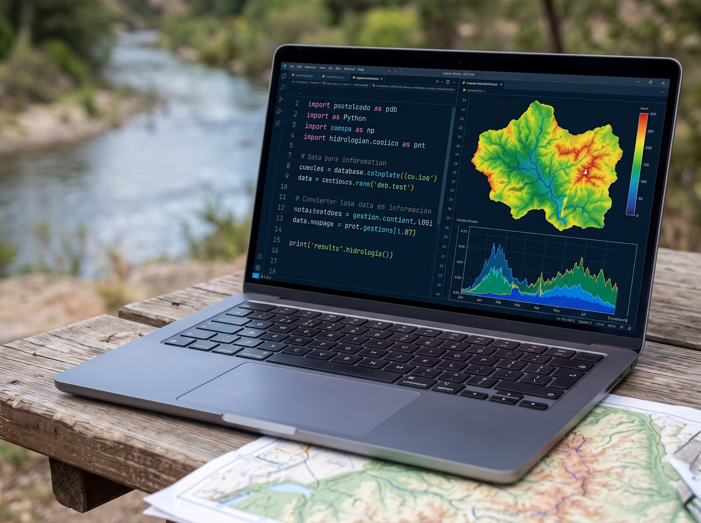
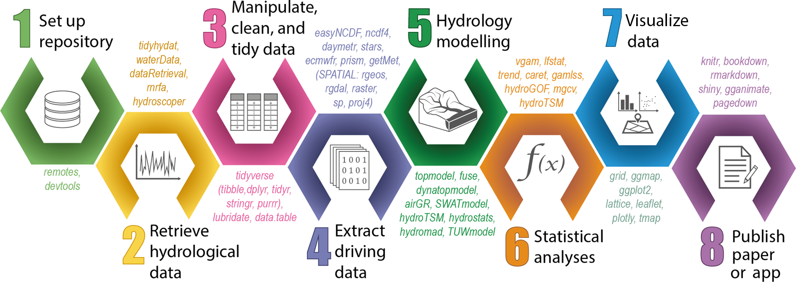
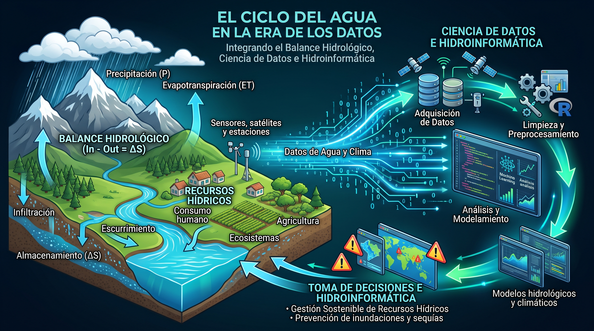
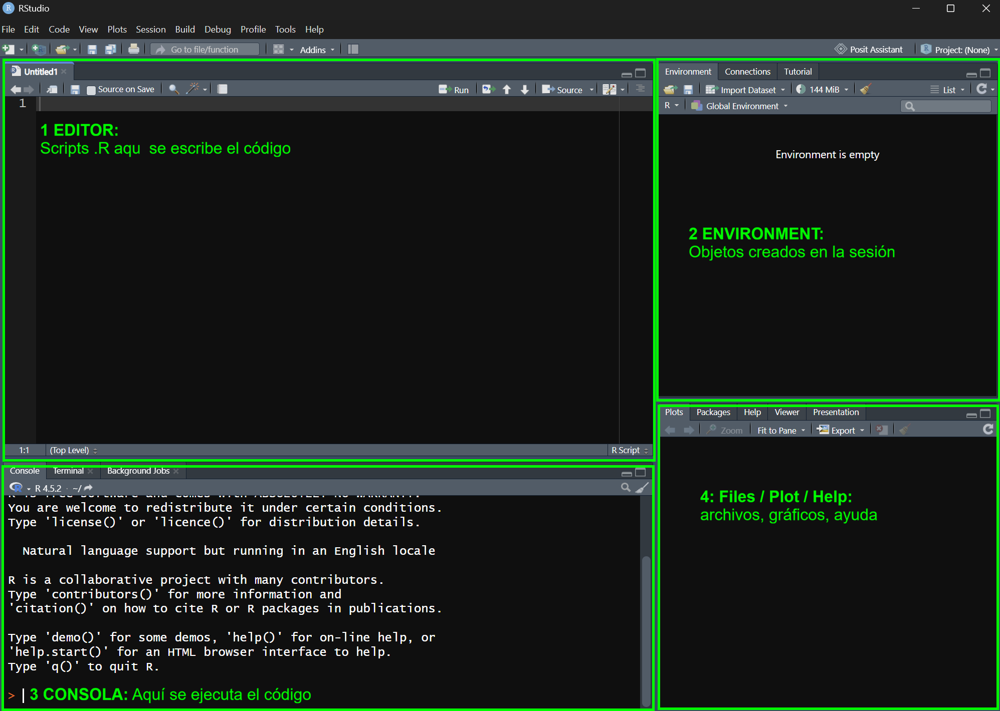

## Contenido día 1 {.contenido background-color="#0B5394"}

1.  Introducción
2.  Fundamentos
3.  Procesamiento y visualización
4.  Automatización
5.  Datos climáticos grillados

## Introducción {.seccion background-color="#0B5394"}

::: {.num}
01
:::

R en Ciencias del Agua y Cambio Climático, Proyectos y Estructuras de Carpetas

## R en Ciencias del Agua y Cambio Climático
:::: {.columns}
::: {.column width="75%"}
::: {.fragment .fade-in}
### Ciencia de datos
- Es un campo interdisciplinario centrado en extraer conocimiento, valor y patrones predictivos a partir de grandes volúmenes de datos (tanto estructurados como no estructurados). Integra matemáticas, estadística aplicada y programación de software
:::

::: {.fragment .fade-in}
### Hidrología computacional
- Es una disciplina que permite a los investigadores gestionar todo el ciclo de la información: desde la obtención, procesamiento y limpieza de grandes volúmenes de datos, hasta su análisis y modelamiento mediante flujos de trabajo específicos. Además facilita la documentación, visualización y el intercambio de resultados en diversas plataformas.
:::

:::

::: {.column width="25%"}
::: {.fragment .fade-in}
{fig-align="center" width="100%"}
:::

::: {.fragment .fade-in}
{fig-align="center" width="100%"}
:::

:::

::::

## R en Ciencias del Agua y Cambio Climático
::: {.fragment .fade-in}
### Hidroinformática
- Es una disciplina que aplica las tecnologías de la información, las ciencias de la computación y la inteligencia artificial al estudio, control y gestión de los recursos hídricos. Nace de la necesidad de integrar la hidrología y la hidráulica tradicionales con herramientas computacionales avanzadas.

::: {.fuente}
Fuente: Abbott, M. B. (1991). *Hydroinformatics: Information technology and the aquatic environment. Avebury Technical.* 
:::
:::

::: {.fragment .fade-in}
{fig-align="center" width="65%"}

::: {.fuente}
Fuente: Slater et al. (2019). *Using R in hydrology: a review of recent developments and future directions*. HESS, 23, 2939–2963. <https://doi.org/10.5194/hess-23-2939-2019>
:::
:::

## R en Ciencias del Agua y Cambio Climático
::: {.fragment .fade-in}
{fig-align="center" width="100%"}
:::

## ¿Por qué R en Hidrología y Cambio Climático?
### De la hoja de cálculo al script
:::: {.columns}
::: {.column width="50%"}
::: {.fragment .fade-in}
**Hoja de cálculo**

- Fórmulas dispersas en celdas
- Pasos manuales difíciles de rastrear
- Otra estación = repetir todo
- Falla de una máquina a otra
- No existe control de versiones
:::
:::

::: {.column width="50%"}
::: {.fragment .fade-in}
**Script en R**

- Cada paso queda escrito y estructurado
- Se ejecuta de nuevo con un clic
- Una función sirve para 1 o 100 estaciones
- Presentación interactiva de resultados
- Control de versiones 
:::
:::
::::

::: {.fragment .fade-in}
R permite procesar grandes volúmenes de datos de forma eficiente, y la presentación interactiva de resultados facilita su comprensión.
:::

::: {.fragment .fade-in}
En los análisis de grandes cuencas y para los enfoques de cambio climático esto es clave: el mismo análisis se repite para **varios modelos, escenarios y periodos**.
:::

## ¿Por qué R en Hidrología y Cambio Climático?
:::: {.columns}
::: {.column width="50%"}
::: {.fragment .fade-in}
**Libre y gratuito**\
No requiere licencia; funciona en Windows, macOS y Linux.

**Construido para analizar datos**\
Estadística y gráficos de calidad desde su origen.
:::
:::

::: {.column width="50%"}
::: {.fragment .fade-in}
**Reproducible**\
El script documenta cada paso del análisis.

**Paquetes hidrológicos**\
`airGR`, `hydroGOF`, `trend`, `qmap`, `terra`, etc.
:::
:::
::::

. . .

CRAN reúne más de 20 000 paquetes y mantiene una guía temática de hidrología (*CRAN Task View: Hydrology*).

::: {.fuente}
Enlace: <https://github.com/cran-task-views/Hydrology/blob/main/Hydrology.md>
:::

## RStudio: Los cuatro paneles

::: {.fragment .fade-in}
{fig-align="center" width="80%"}
:::

## RStudio: atajos y rutas {.smaller}

::: {.fragment .fade-in}

### Atajos de teclado

| Atajo | Acción |
|--------------------|----------------------------------------|
| `Ctrl + Enter` | Ejecutar la línea o la selección |
| `Ctrl + Shift + N` | Nuevo script |
| `Ctrl + S` | Guardar |

:::

. . .

### El problema de `setwd()`

```r
# Solo funciona en MI computadora
setwd("C:/Users/Arnold/Documents/curso/datos")
pp <- read.csv("Precipitaciones.csv")
```

. . .

- Esa ruta no existe en otra computadora
- El script deja de funcionar al compartirlo
- Si mueves la carpeta, tampoco funciona en la tuya

## Proyectos y estructura de carpetas
### Proyectos de RStudio

. . .

- Un proyecto es una carpeta con un archivo `.Rproj`
- Al abrirlo, R trabaja desde esa carpeta
- Las rutas se escriben desde la raíz del proyecto

. . .

```r
getwd()   # carpeta del proyecto

# Funciona en CUALQUIER computadora
pp <- read.csv("data/raw/Precipitaciones.csv")
```

. . .

En el Curso-Taller: doble clic en el archivo `.Rproj` de la carpeta descargada.

Enlace: <https://github.com/arnoldtraverso/Curso-Taller-R-Hidrologia>


## Proyectos y estructura de carpetas {.arbol}

### Estructura del Curso-Taller

. . .


```{=html}
<pre class="arbol-carpetas"><span class="raiz">Curso-Taller-R-Hidrologia/</span>
<span class="rama">├──</span> <span class="rproj">Curso-Taller-R-Hidrologia.Rproj</span>    <span class="nota">← abrir siempre desde aquí</span>
<span class="rama">├──</span> <span class="dir">data/</span>
<span class="rama">│   ├──</span> <span class="dir">raw/</span>                           <span class="nota">datos originales (no se tocan)</span>
<span class="rama">│   └──</span> <span class="dir">processed/</span>                     <span class="nota">datos procesados</span>
<span class="rama">├──</span> <span class="dir">ejercicios/</span>                        <span class="nota">scripts del curso</span>
<span class="rama">├──</span> <span class="dir">outputs/</span>
<span class="rama">│   ├──</span> <span class="dir">figuras/</span>                       <span class="nota">gráficos generados</span>
<span class="rama">│   └──</span> <span class="dir">tablas/</span>                        <span class="nota">tablas generadas</span>
<span class="rama">└──</span> <span class="dir">slides/</span>                            <span class="nota">diapositivas</span></pre>
```

. . .

Los datos de `data/raw/` **no se modifican**: Los resultados se irán generando conforme se avance con los scripts del Curso-Taller.


## Fundamentos {.seccion background-color="#0B5394"}

::: {.num}
02
:::

Objetos, vectores, data frame, listas, fechas con lubridate, paquetes y tidyverse

## Procesamiento y visualización {.seccion background-color="#0B5394"}

::: {.num}
03
:::

Importación (readr, readxl), dplyr/tidyr, NAs y control de calidad, agregación diaria → mensual → anual, ggplot2

## Automatización {.seccion background-color="#0B5394"}

::: {.num}
04
:::

if/else (años secos/húmedos), for sobre múltiples estaciones, funciones propias (ETP Hargreaves), iteración con purrr::map como alternativa

## Datos climáticos grillados {.seccion background-color="#0B5394"}

::: {.num}
05
:::

Paquete terra: lectura de NetCDF, recorte de cuenca, extracción de series, precipitación areal, climatología y mapas


