## Contenido día 1 {.contenido background-color="#0B5394"}

1.  Introducción
2.  Fundamentos
3.  Procesamiento y visualización
4.  Automatización
5.  Datos climáticos grillados

## Introducción {.seccion background-color="#0B5394"}

::: {.num}
01
:::

R en Ciencias del Agua y Cambio Climático, Proyectos y Estructuras de Carpetas

## R en Ciencias del Agua y Cambio Climático
:::: {.columns}
::: {.column width="75%"}
::: {.fragment .fade-in}
### Ciencia de datos
- Es un campo interdisciplinario centrado en extraer conocimiento, valor y patrones predictivos a partir de grandes volúmenes de datos (tanto estructurados como no estructurados). Integra matemáticas, estadística aplicada y programación de software
:::

::: {.fragment .fade-in}
### Hidrología computacional
- Es una disciplina que permite a los investigadores gestionar todo el ciclo de la información: desde la obtención, procesamiento y limpieza de grandes volúmenes de datos, hasta su análisis y modelamiento mediante flujos de trabajo específicos. Además facilita la documentación, visualización y el intercambio de resultados en diversas plataformas.
:::

:::

::: {.column width="25%"}
::: {.fragment .fade-in}
{fig-align="center" width="100%"}
:::

::: {.fragment .fade-in}
{fig-align="center" width="100%"}
:::

:::

::::

## R en Ciencias del Agua y Cambio Climático
::: {.fragment .fade-in}
### Hidroinformática
- Es una disciplina que aplica las tecnologías de la información, las ciencias de la computación y la inteligencia artificial al estudio, control y gestión de los recursos hídricos. Nace de la necesidad de integrar la hidrología y la hidráulica tradicionales con herramientas computacionales avanzadas.

::: {.fuente}
Fuente: Abbott, M. B. (1991). *Hydroinformatics: Information technology and the aquatic environment. Avebury Technical.* 
:::
:::

::: {.fragment .fade-in}
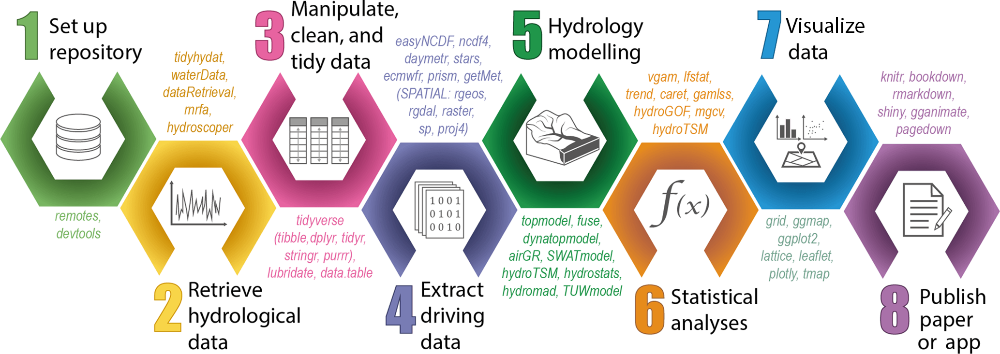{fig-align="center" width="65%"}

::: {.fuente}
Fuente: Slater et al. (2019). *Using R in hydrology: a review of recent developments and future directions*. HESS, 23, 2939–2963. <https://doi.org/10.5194/hess-23-2939-2019>
:::
:::

## R en Ciencias del Agua y Cambio Climático
::: {.fragment .fade-in}
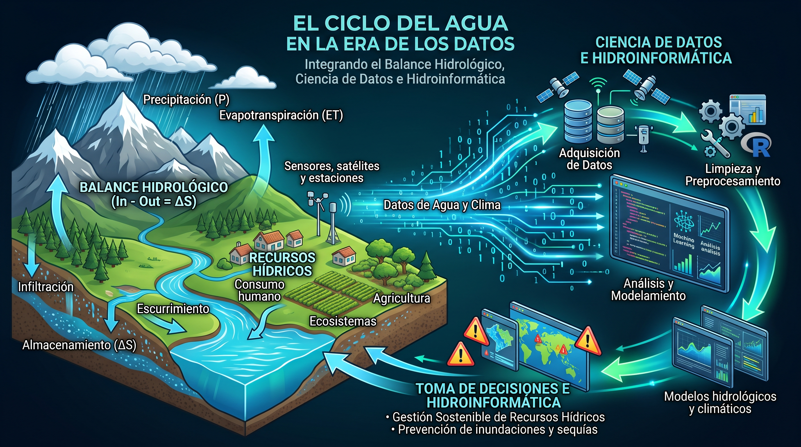{fig-align="center" width="100%"}
:::

## ¿Por qué R en Hidrología y Cambio Climático?
### De la hoja de cálculo al script
:::: {.columns}
::: {.column width="50%"}
::: {.fragment .fade-in}
**Hoja de cálculo**

- Fórmulas dispersas en celdas
- Pasos manuales difíciles de rastrear
- Otra estación = repetir todo
- Falla de una máquina a otra
- No existe control de versiones
:::
:::

::: {.column width="50%"}
::: {.fragment .fade-in}
**Script en R**

- Cada paso queda escrito y estructurado
- Se ejecuta de nuevo con un clic
- Una función sirve para 1 o 100 estaciones
- Presentación interactiva de resultados
- Control de versiones 
:::
:::
::::

::: {.fragment .fade-in}
R permite procesar grandes volúmenes de datos de forma eficiente, y la presentación interactiva de resultados facilita su comprensión.
:::

::: {.fragment .fade-in}
En los análisis de grandes cuencas y para los enfoques de cambio climático esto es clave: el mismo análisis se repite para **varios modelos, escenarios y periodos**.
:::

## ¿Por qué R en Hidrología y Cambio Climático?
:::: {.columns}
::: {.column width="50%"}
::: {.fragment .fade-in}
**Libre y gratuito**\
No requiere licencia; funciona en Windows, macOS y Linux.

**Construido para analizar datos**\
Estadística y gráficos de calidad desde su origen.
:::
:::

::: {.column width="50%"}
::: {.fragment .fade-in}
**Reproducible**\
El script documenta cada paso del análisis.

**Paquetes hidrológicos**\
`airGR`, `hydroGOF`, `trend`, `qmap`, `terra`, etc.
:::
:::
::::

. . .

CRAN reúne más de 20 000 paquetes y mantiene una guía temática de hidrología (*CRAN Task View: Hydrology*).

::: {.fuente}
Enlace: <https://github.com/cran-task-views/Hydrology/blob/main/Hydrology.md>
:::

## RStudio: Los cuatro paneles

::: {.fragment .fade-in}
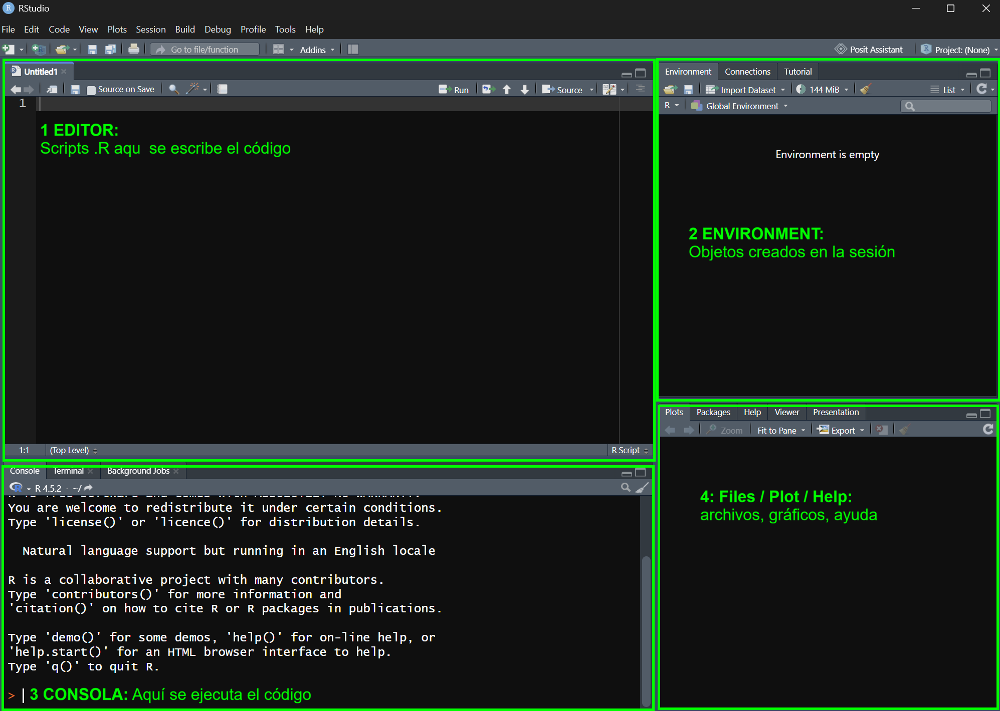{fig-align="center" width="70%"}
:::

::: {.fuente}
Enlace: <https://rstudio.github.io/cheatsheets/html/rstudio-ide.html>
:::


## RStudio: atajos y rutas {.smaller}

::: {.fragment .fade-in}

### Atajos de teclado

| Atajo | Acción |
|--------------------|----------------------------------------|
| `Ctrl + Enter` | Ejecutar la línea o la selección |
| `Ctrl + Shift + N` | Nuevo script |
| `Ctrl + S` | Guardar |

:::

. . .

### El problema de `setwd()`

```r
# Solo funciona en MI computadora
setwd("C:/Users/Arnold/Documents/curso/datos")
pp <- read.csv("Precipitaciones.csv")
```

. . .

- Esa ruta no existe en otra computadora
- El script deja de funcionar al compartirlo
- Si mueves la carpeta, tampoco funciona en la tuya

## Proyectos y estructura de carpetas
### Proyectos de RStudio

. . .

- Un proyecto es una carpeta con un archivo `.Rproj`
- Al abrirlo, R trabaja desde esa carpeta
- Las rutas se escriben desde la raíz del proyecto

. . .

```r
getwd()   # carpeta del proyecto

# Funciona en CUALQUIER computadora
pp <- read.csv("data/raw/Precipitaciones.csv")
```

. . .

En el Curso-Taller: doble clic en el archivo `.Rproj` de la carpeta descargada.

Enlace: <https://github.com/arnoldtraverso/Curso-Taller-R-Hidrologia>


## Proyectos y estructura de carpetas {.arbol}

### Estructura del Curso-Taller

. . .


```{=html}
<pre class="arbol-carpetas"><span class="raiz">Curso-Taller-R-Hidrologia/</span>
<span class="rama">├──</span> <span class="rproj">Curso-Taller-R-Hidrologia.Rproj</span>    <span class="nota">← abrir siempre desde aquí</span>
<span class="rama">├──</span> <span class="dir">data/</span>
<span class="rama">│   ├──</span> <span class="dir">raw/</span>                           <span class="nota">datos originales (no se tocan)</span>
<span class="rama">│   └──</span> <span class="dir">processed/</span>                     <span class="nota">datos procesados</span>
<span class="rama">├──</span> <span class="dir">ejercicios/</span>                        <span class="nota">scripts del curso</span>
<span class="rama">├──</span> <span class="dir">outputs/</span>
<span class="rama">│   ├──</span> <span class="dir">figuras/</span>                       <span class="nota">gráficos generados</span>
<span class="rama">│   └──</span> <span class="dir">tablas/</span>                        <span class="nota">tablas generadas</span>
<span class="rama">└──</span> <span class="dir">slides/</span>                            <span class="nota">diapositivas</span></pre>
```

. . .

Los datos de `data/raw/` **no se modifican**: Los resultados se irán generando conforme se avance con los scripts del Curso-Taller.


## Fundamentos {.seccion background-color="#0B5394"}

::: {.num}
02
:::

Objetos, vectores, data frame, listas, fechas con lubridate, paquetes y tidyverse

## Estructuras de datos

::: {.fragment .fade-in}
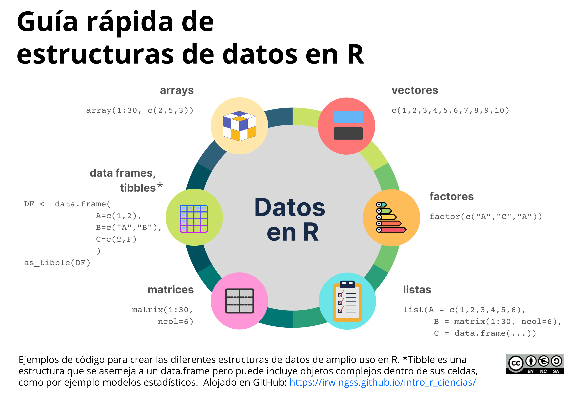{fig-align="center" width="70%"}

::: {.fuente}
Imagen tomada del 
Enlace: <https://irwingss.github.io/intro_r_ciencias/estructurasdatos.html>

:::

:::

## Objetos y asignación

::: {.fragment .fade-in}

### Guardar un valor con `<-`

```r
caudal   <- 12.69            # m³/s, Huancané el 01/01/2024
estacion <- "Huancane"       # el uso de tilde a veces genera errores
caudal                       # escribir el nombre muestra su valor
#> [1] 12.69
```
:::

. . .

### R como calculadora hidrológica

```r
vol_dia <- caudal * 86400    # m³ que pasan en un día
vol_dia
#> [1] 1096416
vol_dia / 1e6                # en hm³ (millones de m³)
#> [1] 1.096416
```

. . .

::: {.fuente}
Nombres válidos: empiezan con letra, sin espacios ni tildes (`pp_anual`, no `pp anual` ni `precipitación`). R distingue mayúsculas: `Caudal` ≠ `caudal`.
:::

## Tipos de datos

. . .


| Tipo | Ejemplo | Uso en hidrología |
|------------|------------------------|-------------------------------|
| `numeric` | `12.69` | caudal, precipitación, altitud |
| `character` | `"Huancane"` | nombre o código de estación |
| `logical` | `TRUE`, `FALSE` | ¿es año seco?, ¿falta el dato? |
| `Date` | `as.Date("2024-01-01")` | fecha de la observación |

. . .

Verificar los valores durante el proceso de escribir código es importante!

```r
class(caudal)          #> "numeric"
class(estacion)        #> "character"
caudal > 10            #> TRUE
is.na(NA)              #> TRUE    NA = dato faltante
```

## Vectores
### Precipitación mensual promedio — Huancané (1991–2020)

. . .


```r
# Valores de enero a diciembre
pp_mensual <- c(134.0, 104.9, 104.2, 36.8, 11.2, 7.0,
                4.2, 8.8, 25.0, 56.4, 58.6, 105.8)
# Asignamos nombres
names(pp_mensual) <- month.abb    # Jan, Feb, ..., Dec
# Verificamos la longitud de datos
length(pp_mensual)   #> 12
```

. . .

Operaciones básicas en la serie mensual

```r
sum(pp_mensual)      #> 656.9   precipitación anual (mm)
mean(pp_mensual)     #> 54.7    promedio
max(pp_mensual)      #> 134     valor máximo  
min(pp_mensual)      #> 4.2     valor mínimo
which.max(pp_mensual) #> Jan 1  mes más lluvioso
```

. . .

Las operaciones se aplican **a todos los elementos a la vez**:

```r
pp_mensual / 10                    # de mm a cm
round(pp_mensual / sum(pp_mensual) * 100, 1)  # % del total anual (mes a mes)
```

## Vectores: seleccionar elementos

. . .

La selección se realiza empleando **Corchetes**
```r
pp_mensual[1]                  # primer elemento (enero)
pp_mensual[c(12, 1, 2, 3)]     # temporada de lluvias DEFM
pp_mensual["Jul"]              # por nombre
```

. . .

### Condiciones lógicas

```r
pp_mensual > 100
#>   Jan   Feb   Mar   Apr ...   Dec
#>  TRUE  TRUE  TRUE FALSE ...  TRUE

pp_mensual[pp_mensual > 100]   # solo los meses con más de 100 mm
#>   Jan   Feb   Mar   Dec
#> 134.0 104.9 104.2 105.8

sum(pp_mensual[c(12, 1, 2, 3)]) / sum(pp_mensual) * 100
#> 68.3   % de la lluvia anual cae en DEFM
```

## Data frame

. . .


### Tabla de estaciones (una fila = una estación)

Estructura clásica de un data frame

```r
estaciones <- data.frame(
  nombre  = c("Ananea", "Muñani", "Putina", "Huancané", "Cojata"),
  codigo  = c("000826", "000785", "157414", "000786", "000827"),
  lat     = c(-14.676, -14.767, -14.921, -15.207, -15.012),
  lon     = c(-69.534, -69.952, -69.876, -69.758, -69.361),
  altitud = c(4660, 3932, 3861, 3842, 4347)
)
```

. . .

Explorando el **data.frame**

```r
str(estaciones)       # ver la estructura: columnas y tipos
nrow(estaciones)      #> 5
names(estaciones)     #> "nombre" "codigo" "lat" "lon" "altitud"
```

::: {.fuente}
`codigo` va entre comillas: si fuera número, R borraría los ceros iniciales (`000826` → `826`).
:::

## Data frame: acceder a los datos

. . .

Verificar el contenido del **data.frame**

```r
estaciones$altitud              # una columna (vector)
mean(estaciones$altitud)        #> 4128.4
estaciones[2, ]                 # fila 2 (Muñani)
estaciones[ , c("nombre", "altitud")]   # dos columnas
```

. . .


Aplicando una condición básica
```r
# Filas que cumplen una condición
estaciones[estaciones$altitud > 4000, ]
#>   nombre codigo     lat     lon altitud
#> 1 Ananea 000826 -14.676 -69.534    4660
#> 5 Cojata 000827 -15.012 -69.361    4347
```

. . .

Agregar una nueva columna se realiza con **$**

```r
# Crear una columna nueva
estaciones$zona <- ifelse(estaciones$altitud > 4000, "alta", "media")
```

## Listas

. . .


### Un objeto que guarda objetos de distinto tipo

Asignamos las características de la Est. Huancané (nombre, código, coordenadas, valores)
```r
huancane <- list(
  nombre     = "Huancané",
  codigo     = "000786",
  coord      = c(lat = -15.207, lon = -69.758),
  pp_mensual = pp_mensual
)
```

. . .

Explorando la lista, empleamos **$** y **corchetes**

```r
huancane$nombre          #> "Huancané"
huancane$coord["lat"]    #> -15.207
huancane[["pp_mensual"]] # vector completo de 12 meses
```

. . .

::: {.fuente}
Las listas son clave para automatizar: en la sección 04 guardaremos **una estación por elemento** y aplicaremos la misma función a todas con `purrr::map()`.
:::

## Fechas con lubridate

. . .


### Los datos del visor ANA traen la fecha como texto

```r
# Cargamos la librería para fechas
library(lubridate)

fecha_txt <- "04/05/2026"        # día/mes/año
class(fecha_txt)                 #> "character"

# Cambiamos al formato adecuado
fecha <- dmy(fecha_txt)          # d-m-y: día, mes, año
fecha                            #> "2026-05-04" año, mes, día
class(fecha)                     #> "Date", verificamos la clase
```

. . .

Exploramos las fechas con las funciones

```r
year(fecha)     #> 2026
month(fecha)    #> 5
yday(fecha)     #> 124      día del año
fecha + 30      #> "2026-06-03"
```

## Fechas: secuencias y diferencias

. . .

Creando la secuencia de fechas o vector fecha

```r
# Primera forma
dias <- seq(ymd("2024-01-01"), ymd("2024-12-31"), by = "day")
length(dias)                     #> 366   (2024 es bisiesto)

meses <- seq(ymd("1991-01-01"), ymd("2020-12-01"), by = "month")
length(meses)                    #> 360   (30 años × 12)

# Segunda forma
dias <- seq(as.Date("2024-01-01"), as.Date("2024-12-31"), by = "day")
meses <- seq(as.Date("1991-01-01"), as.Date("2020-12-01"), by = "month")

```

. . .

```r
inicio <- ymd("1956-01-01")      # inicio del registro de caudal
fin    <- ymd("2026-05-04")
fin - inicio                     #> Time difference of 25691 days
```

. . .

::: {.fuente}
El registro tiene 25 208 días con dato, pero el periodo abarca 25 692: **faltan 484 días** que no aparecen ni como `NA`. Las secuencias de fechas sirven para detectarlos (sección 03).
:::

## Paquetes y tidyverse

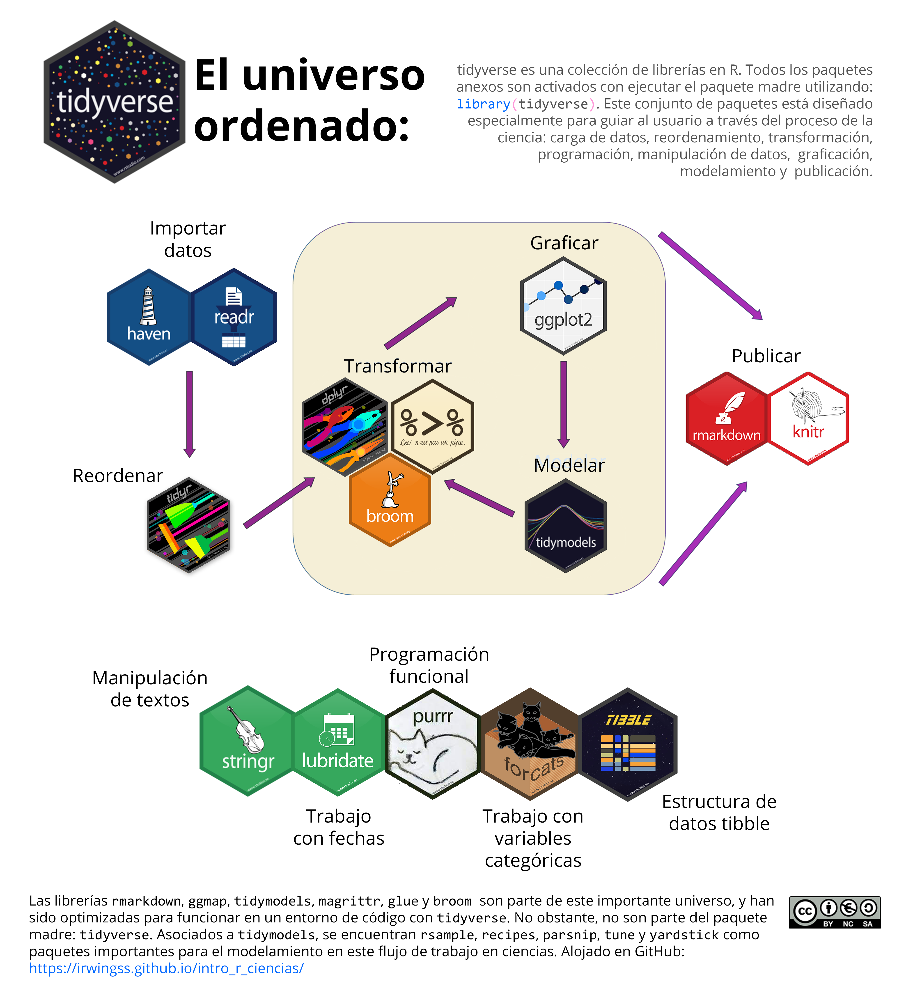{.nostretch fig-align="center" height="540px"}

::: {.fuente}
Imagen tomada de: <https://irwingss.github.io/intro_r_ciencias/tidyversecap.html>
:::


## Paquetes y tidyverse

### Instalación y principales funciones:
::: {.fragment .fade-in}
:::: {.columns}
::: {.column width="50%"}
```r
# Se instala UNA vez
install.packages("tidyverse")

# Se carga en CADA sesión
library(tidyverse)
library(readxl)
```
:::

::: {.column width="50%"}
| Paquete | Para qué |
|-----------|----------------------|
| `readr` / `readxl` | importar datos |
| `dplyr` | filtrar, resumir |
| `tidyr` | reordenar tablas |
| `lubridate` | fechas |
| `ggplot2` | gráficos |
| `purrr` | repetir tareas |
:::
::::
:::

. . .

::: {.fragment .fade-in}

### El pipe `|>`: "y luego..."

```r
round(mean(pp_mensual), 1)              # se lee de adentro hacia afuera

pp_mensual |> mean() |> round(1)        # se lee de izquierda a derecha
#> 54.7
```

:::

## Primer contacto con los datos reales
### Importamos los caudales de Huancané
::: {.fragment .fade-in}

```r
library(readxl)

q <- read_excel("data/raw/caudal/Q_210201_PteCarretera_Huancane.xlsx",
                skip = 13)       # saltar las 13 filas de metadatos
head(q, 3)
#>   FECHA      HORA  `VALOR (m³/s)`
#> 1 04/05/2026 00:00          17.41
#> ...
```
:::

::: {.fragment .fade-in}

### ¿Qué hay que arreglar?

- `FECHA` es texto → convertir con `dmy()`
- Está ordenado de **2026 a 1956** → ordenar
- Faltan días sin fila → completar y contar vacíos
- En precipitación hay **días duplicados** (2017–2024)

. . .

Eso es la sección 03: **procesamiento y control de calidad**.

:::

## Procesamiento y visualización {.seccion background-color="#0B5394"}

::: {.num}
03
:::

Importación (readr, readxl), dplyr/tidyr, NAs y control de calidad, agregación diaria → mensual → anual, ggplot2

## Importar y ordenar el caudal
### Importamos el caudal
```r
library(tidyverse)
library(readxl)

q <- read_excel("data/raw/caudal/Q_210201_PteCarretera_Huancane.xlsx",
                skip = 13) |>
  rename(fecha = FECHA, hora = HORA, q = 3) |>  # nombres cortos
  mutate(fecha = dmy(fecha)) |>                 # texto → Date
  arrange(fecha) |>                             # de 1956 a 2026
  select(fecha, q)                              # columnas útiles
```

. . .

```r
q
#>   fecha          q
#> 1 1956-01-01  0.08
#> 2 1956-01-02  0.05
#> ...
nrow(q)            #> 25208
```

::: {.fuente}
Una sola cadena con `|>` resuelve los tres problemas de la sección 02: nombres, tipo de fecha y orden.
:::

## Los verbos de dplyr

### Entendemos las principales funciones:
::: {.fragment .fade-in}

| Verbo | Qué hace | Ejemplo con el caudal |
|-------------|-----------------------------|---------------------------------------|
| `filter()` | elige filas | `filter(q > 200)` → 72 días |
| `mutate()` | crea columnas | `mutate(vol_hm3 = q * 86400 / 1e6)` |
| `arrange()` | ordena | `arrange(desc(q))` → 368.6 el 27/02/2016 |
| `select()` | elige columnas | `select(fecha, q)` |
| `summarise()` | resume | `summarise(q_medio = mean(q))` → 18.3 |

:::

::: {.fragment .fade-in}

. . .

### `group_by()` + `summarise()`: resumir por grupos

```r
q |>
  group_by(anio = year(fecha)) |>
  summarise(q_medio = mean(q), q_max = max(q))
```

:::

## Completar las fechas faltantes

### Los días sin dato no tienen fila → hay que crearlos

```r
q_full <- q |>
  complete(fecha = seq(min(fecha), max(fecha), by = "day"))

nrow(q_full)            #> 25692
sum(is.na(q_full$q))    #> 484   ahora sí aparecen como NA
```

. . .

```r
q_full |>
  group_by(anio = year(fecha)) |>
  summarise(n_na = sum(is.na(q))) |>
  arrange(desc(n_na))
#>   anio  n_na
#>   1975   244
#>   2020   119
#>   1985    32
```

## Precipitación: registros duplicados

### Importamos la precipitación de la Est. Huancané
::: {.fragment .fade-in}

```r
pp <- read_excel("data/raw/precipitacion/PP_000786_Huancane.xlsx", skip = 13) |>
  rename(fecha = FECHA, hora = HORA, pp = 3) |>
  mutate(fecha = dmy(fecha))

table(pp$hora)
#> 00:00 01:00 05:00
#> 19030     1  1260

pp |> count(fecha) |> filter(n > 1) |> nrow()
#> 1260   fechas repetidas entre 2017 y 2024
```
:::

. . .

```r
pp |> group_by(fecha) |> filter(n() > 1, n_distinct(pp) > 1)
#>   fecha      hora     pp
#>   2017-02-28 00:00  21.9
#>   2017-02-28 05:00   2.9     ← ¿cuál es el correcto?
```

## Precipitación: una fila por día

```r
pp |> filter(year(fecha) == 2019) |> summarise(total = sum(pp))
#> 1334.5 mm   ← ¡casi el doble de lo normal!
```

. . .

### Regla del curso: usar 00:00; si no existe, 05:00

```r
pp <- pp |>
  arrange(fecha, hora) |>            # "00:00" queda antes que "05:00"
  distinct(fecha, .keep_all = TRUE) |>   # conserva la primera fila
  select(fecha, pp)

pp |> filter(year(fecha) == 2019) |> summarise(total = sum(pp))
#> 685.8 mm
```

. . .

::: {.fuente}
Antes de calcular cualquier estadístico hay que conocer el dato: un error de formato puede duplicar la lluvia anual sin que aparezca ningún mensaje de error.
:::

## Control de calidad básico

```r
q_full |> summarise(negativos = sum(q < 0, na.rm = TRUE),
                    ceros     = sum(q == 0, na.rm = TRUE))
#>   negativos ceros
#>           0     6     ← 2012 y 2014: revisar

pp_full |> summarise(negativos = sum(pp < 0, na.rm = TRUE),
                     maximo    = max(pp, na.rm = TRUE))
#>   negativos maximo
#>           0   68.7    ← 15/03/1994
```

. . .

```r
vacios_pp <- pp_full |>
  group_by(anio = year(fecha), mes = month(fecha)) |>
  summarise(n_na = sum(is.na(pp)), .groups = "drop")
```

## Control de calidad: mapa de vacíos

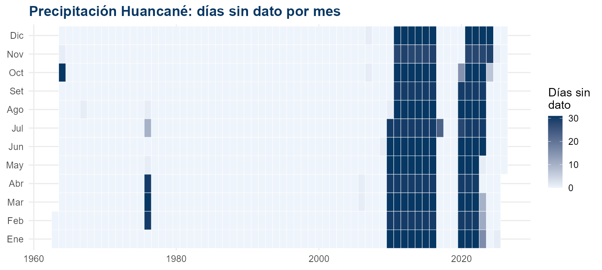{.nostretch fig-align="center" width="85%"}

::: {.fuente}
Estación Huancané (000786): dos grandes vacíos, de junio 2010 a diciembre 2016 (79 meses) y de marzo 2020 a julio 2023 (41 meses), más meses incompletos hasta marzo 2024. Antes de usar una estación hay que saber **qué periodo cubre realmente**.
:::

## Agregación: diaria → mensual

```r
max_na <- 3     # un mes es válido con 3 días sin dato como máximo

q_mensual <- q_full |>
  group_by(anio = year(fecha), mes = month(fecha)) |>
  summarise(n_na = sum(is.na(q)),
            q    = mean(q, na.rm = TRUE),     # caudal: PROMEDIO
            .groups = "drop") |>
  mutate(q = if_else(n_na > max_na, NA, q))
```

. . .

```r
pp_mensual <- pp_full |>
  group_by(anio = year(fecha), mes = month(fecha)) |>
  summarise(n_na = sum(is.na(pp)),
            pp   = sum(pp, na.rm = TRUE),     # precipitación: SUMA
            .groups = "drop") |>
  mutate(pp = if_else(n_na > max_na, NA, pp))
```

## Agregación: mensual → anual

```r
q_anual <- q_mensual |>
  group_by(anio) |>
  summarise(n_meses = sum(!is.na(q)),   # se calcula ANTES que q
            q       = mean(q)) |>
  filter(n_meses == 12)                 # solo años completos

q_anual |> arrange(q) |> head(3)
#>   anio n_meses     q
#>   2023      12  4.75   ← el año más seco del registro
#>   1983      12  7.23
#>   1967      12  7.67
```

. . .

::: {.fuente}
`summarise()` calcula en orden: si `q` se calculara primero, `n_meses` contaría sobre el valor anual y no sobre los 12 meses.
:::

## ggplot2: la gramática de los gráficos

:::: {.columns}
::: {.column width="45%"}
```r
ggplot(q_full,
       aes(x = fecha, y = q)) +
  geom_line(color = "#0B5394",
            linewidth = 0.25) +
  labs(title = "Caudal diario",
       x = NULL,
       y = "Caudal (m³/s)") +
  theme_minimal()
```
:::

::: {.column width="55%"}
- `ggplot()`: **datos**
- `aes()`: qué variable va en cada **eje**
- `geom_*()`: la **forma** (línea, barra, punto)
- `labs()`, `theme()`: títulos y estilo
- Las capas se suman con `+`
:::
::::

. . .

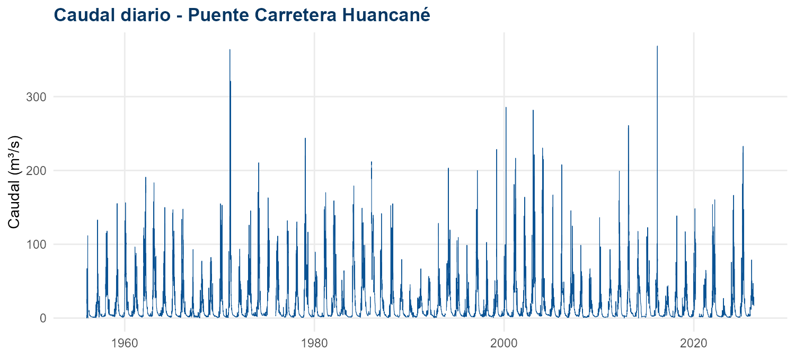{.nostretch fig-align="center" width="62%"}

## ggplot2: régimen y variabilidad

:::: {.columns}
::: {.column width="50%"}
```r
ggplot(q_clim, aes(factor(mes), q)) +
  geom_col(fill = "#0B5394")
```
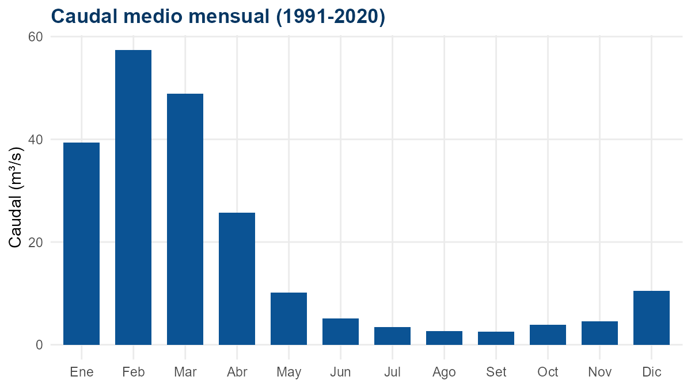{width="100%"}
:::

::: {.column width="50%"}
```r
ggplot(q_anual, aes(anio, q)) +
  geom_col(aes(fill = anio == 2023)) +
  geom_hline(yintercept = q_medio)
```
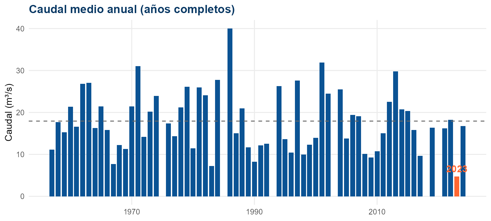{width="100%"}
:::
::::

::: {.fuente}
Febrero concentra el mayor caudal (57.4 m³/s) y setiembre el menor (2.6 m³/s). En 2023 el caudal medio anual fue de 4.75 m³/s, una cuarta parte del promedio (17.9 m³/s).
:::

## Exportar resultados

```r
# Tablas procesadas
write_csv(q_full,     "data/processed/Q_diario_Huancane.csv")
write_csv(pp_mensual, "data/processed/PP_mensual_Huancane.csv")
write_csv(q_anual,    "outputs/tablas/Q_anual_Huancane.csv")

# Figuras
ggsave("outputs/figuras/Q_hidrograma.png", g_hidro,
       width = 10, height = 4.5, dpi = 150)
```

. . .

- `data/raw/` sigue intacto: todo se puede **regenerar** ejecutando el script
- Script completo: `ejercicios/02_Procesamiento.R` (con ejercicios E1–E6)

## Automatización {.seccion background-color="#0B5394"}

::: {.num}
04
:::

Funciones propias, if/else (años secos/húmedos), for sobre múltiples estaciones, iteración con purrr::map

## Funciones propias

### Escribir la limpieza UNA vez y reutilizarla

**Creando la función de lectura de datos**


. . .

```r
leer_datos <- function(archivo) {
  read_excel(archivo, skip = 13) |>
    rename(fecha = 1, hora = 2, valor = 3) |>
    mutate(fecha = dmy(fecha)) |>
    arrange(fecha, hora) |>
    distinct(fecha, .keep_all = TRUE) |>        # regla 00:00 → 05:00
    select(fecha, valor) |>
    complete(fecha = seq(min(fecha), max(fecha), by = "day"))
}
```

. . .

```r
q  <- leer_datos("data/raw/caudal/Q_210201_PteCarretera_Huancane.xlsx")
pp <- leer_datos("data/raw/precipitacion/PP_000786_Huancane.xlsx")
nrow(q)     #> 25692
```

::: {.fuente}
Todo el procesamiento de la sección 03 quedó en una línea. Si mañana cambia el formato del ANA, se corrige **en un solo lugar**.
:::

## Funciones: argumentos por defecto

```r
agregar_mensual <- function(datos, fun = sum, max_na = 3) {
  datos |>
    group_by(anio = year(fecha), mes = month(fecha)) |>
    summarise(n_na  = sum(is.na(valor)),
              valor = fun(valor, na.rm = TRUE),
              .groups = "drop") |>
    mutate(valor = if_else(n_na > max_na, NA, valor))
}
```

. . .

```r
pp_mensual <- agregar_mensual(pp)                         # suma (por defecto)
q_mensual  <- agregar_mensual(q, fun = mean)              # promedio
q_estricto <- agregar_mensual(q, fun = mean, max_na = 0)  # sin vacíos
```

::: {.fuente}
En el script también está `agregar_anual()`, que conserva solo los años con 12 meses válidos: 62 años de caudal.
:::

## Condicionales: if / else
:::: {.columns}
::: {.column width="55%"}
::: {.fragment .fade-in}
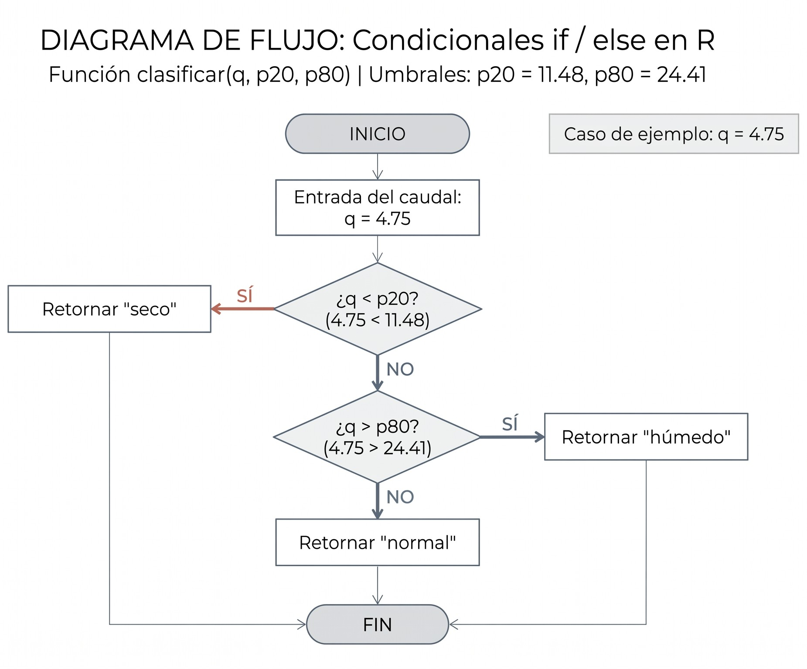{fig-align="center" width="85%"}
:::
:::

::: {.column width="45%"}
::: {.fragment .fade-in style="font-size: 0.8em;"}

```r
umbrales <- quantile(q_anual$valor,
                     c(0.2, 0.8))
#>   20%   80%
#> 11.48 24.41

clasificar <- function(q, p20, p80) {
  if (q < p20) {
    "seco"
  } else if (q > p80) {
    "húmedo"
  } else {
    "normal"
  }
}

# caudal medio de 2023
clasificar(4.75, umbrales[1], umbrales[2])
#> "seco"
```
:::
:::
::::

## Condicionales para una columna: `case_when()`
:::: {.columns}
::: {.column width="55%"}
::: {.fragment .fade-in}
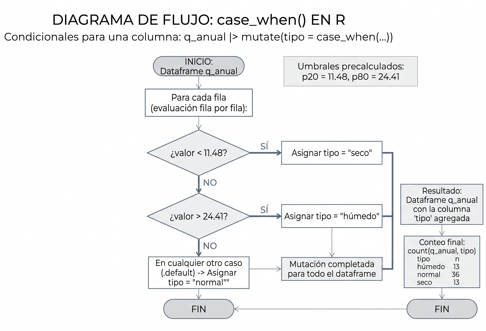{fig-align="center" width="100%"}

:::
:::

::: {.column width="45%"}
::: {.fragment .fade-in}
```r
q_anual <- q_anual |>
  mutate(tipo = case_when(
    valor < umbrales[1] ~ "seco",
    valor > umbrales[2] ~ "húmedo",
    .default            = "normal"
  ))

count(q_anual, tipo)
#>   tipo       n
#>   húmedo    13
#>   normal    36
#>   seco      13
```

:::
:::
::::

. . .

::: {.fuente}
`if()` evalúa **un solo valor**; `case_when()` evalúa una columna completa. Los años más secos: 2023 (4.75), 1983 (7.23), 1967 (7.67), 1990 (8.23) y 2009 (9.29 m³/s).
:::

## Bucles for: la idea

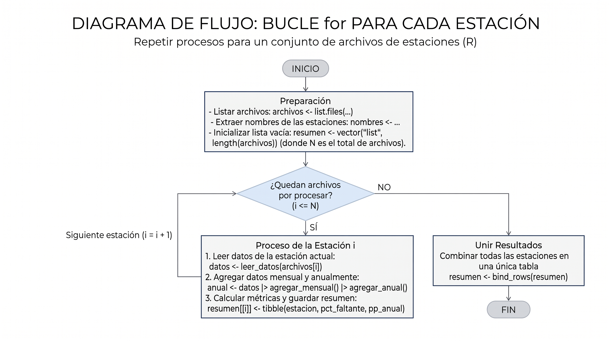{.nostretch fig-align="center" height="580px"}

## Bucles for: repetir para cada estación

```r
archivos <- list.files("data/raw/precipitacion", pattern = "\\.xlsx$",
                       full.names = TRUE)
nombres <- archivos |> basename() |> str_remove("\\.xlsx$") |> str_remove("^PP_\\d+_")
#> "Munani" "Huancane" "Ananea" "Cojata" "Putina"
```

::: {.fragment .fade-in}
```r
resumen <- vector("list", length(archivos))      # lista vacía

for (i in seq_along(archivos)) {
  datos <- leer_datos(archivos[i])
  anual <- datos |> agregar_mensual() |> agregar_anual()
  resumen[[i]] <- tibble(
    estacion     = nombres[i],
    pct_faltante = round(mean(is.na(datos$valor)) * 100, 1),
    pp_anual     = mean(anual$valor[anual$anio %in% 1991:2020])
  )
}
resumen <- bind_rows(resumen)
```
:::


## Bucles for: el resultado

| Estación | Periodo | % faltante | Años comp. | PP 1991–2020 (mm) |
|----------|-------------|-----:|-----:|-----:|
| Muñani | 1964–2026 | 14.8 | 46 | 646.9 |
| Huancané | 1963–2026 | 17.0 | 47 | 658.3 |
| Ananea | 1963–2024 | 14.3 | 49 | 623.6 |
| Cojata | 1956–2026 | 1.5 | 59 | 711.4 |
| Putina | 1970–2026 | 14.7 | 40 | 640.1 |

. . .

::: {.fuente}
Cinco estaciones procesadas con el mismo código. Con 50 estaciones, el bucle sería exactamente el mismo.
:::

## Iteración con `purrr::map()`
::: {.fragment .fade-in}
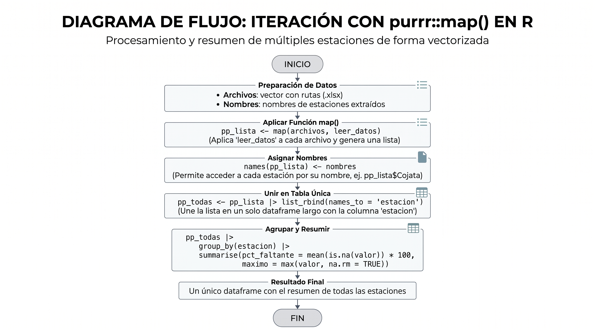{fig-align="center" width="100%"}
:::

## Iteración con `purrr::map()`

::: {.fragment .fade-in}
### Aplicando la función map()
```r
pp_lista <- map(archivos, leer_datos)   # aplica la función a cada archivo
names(pp_lista) <- nombres
pp_lista$Cojata                         # una estación de la lista
```
:::

. . .

### Ordenando los datos

```r
# Une la lista en UNA tabla larga con la columna "estacion"
pp_todas <- pp_lista |> list_rbind(names_to = "estacion")
nrow(pp_todas)       #> 114159

# Con la tabla larga, group_by() reemplaza al bucle
pp_todas |>
  group_by(estacion) |>
  summarise(pct_faltante = mean(is.na(valor)) * 100,
            maximo       = max(valor, na.rm = TRUE))
```

. . .

::: {.fuente}
`for` y `map()` hacen lo mismo; `map()` es más corto y no necesita preparar la lista vacía.
:::

## Todas las estaciones en un gráfico
### Empleando ggplot2 y facet_wrap
:::: {.columns}
::: {.column width="48%"}
```r
# Anual de cada estación, en una tabla
pp_anual <- pp_lista |>
  map(\(d) d |>
        agregar_mensual() |>
        agregar_anual()) |>
  list_rbind(names_to = "estacion")

# Un color por estación
colores <- c(Ananea   = "#0B5394",
             Cojata   = "#6AA84F",
             Huancane = "#E69138",
             Munani   = "#8E7CC3",
             Putina   = "#CC4125")
```
:::

::: {.column width="52%"}
```r
ggplot(pp_anual, aes(anio, valor,
                     fill = estacion)) +
  geom_col(width = 0.8) +
  # línea base en 0
  geom_hline(yintercept = 0,
             linewidth = 0.8) +
  facet_wrap(~ estacion, ncol = 1) +
  # años cada 10
  scale_x_continuous(
    breaks = seq(1950, 2030, 10)) +
  scale_fill_manual(values = colores,
                    guide = "none")
```
:::
::::

::: {.fuente}
`fill = estacion` da un color a cada estación; `scale_fill_manual()` elige cuáles. `guide = "none"` quita la leyenda, porque el nombre ya está en cada panel.
:::

## Todas las estaciones: el resultado

::: {.fragment .fade-in}

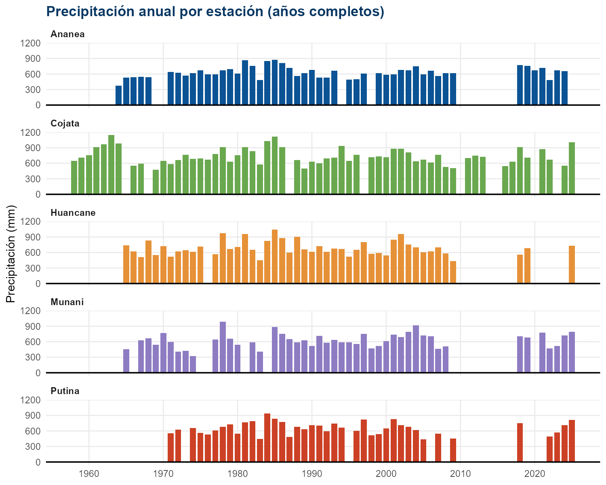{.nostretch width="60%" fig-align="center"}

::: {.fuente}
`facet_wrap()` hace un panel por estación. Entre 2010 y 2016 **solo Cojata** tiene años completos: es un vacío de toda la red, no de una estación.
:::
::::

## Datos climáticos grillados {.seccion background-color="#0B5394"}

::: {.num}
05
:::

Paquete terra: lectura de NetCDF, recorte de cuenca, climatología, mapas, precipitación areal y balance P – ETP

## PISCO: datos grillados del Perú

:::: {.columns}
::: {.column width="50%"}
::: {.fragment .fade-in style="font-size: 0.85em;"}
**Características**

-   **PISCOp v3.0** (SENAMHI): precipitación **diaria** 1981–2025, celdas de 0.1° (~11 km)
-   Formato **NetCDF** (`.nc`): un "cubo" longitud × latitud × tiempo
-   El archivo nacional pesa **1.5 GB** (16 436 días)
:::
:::

::: {.column width="50%"}
::: {.fragment .fade-in}
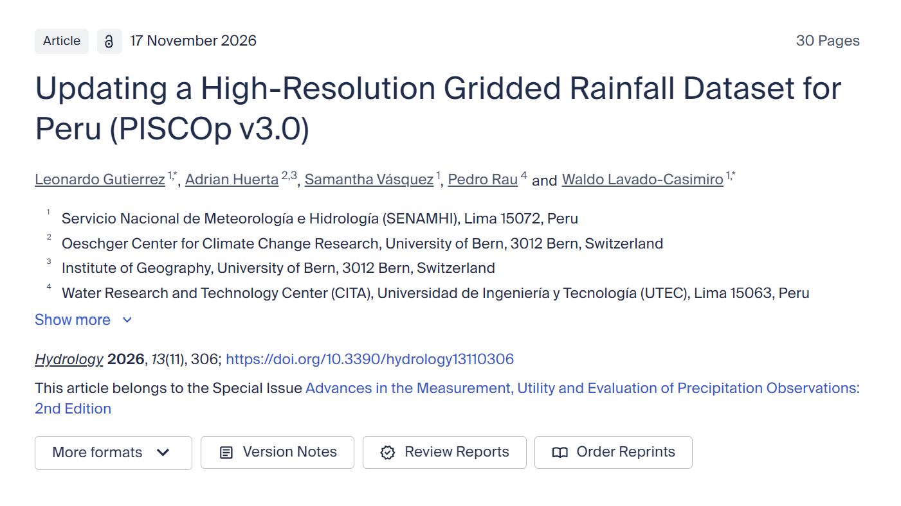{width="100%" fig-align="center"}
:::
:::

::: {.fragment .fade-in}
```r
# Recorte de la cuenca (lo hace el instructor UNA vez)
nc <- ncdf4::nc_open("data/raw/pisco/PISCOp_d.nc")
a  <- ncdf4::ncvar_get(nc, "precipitation",
                       start = c(min(ix), min(iy), 1),        # esquina
                       count = c(length(ix), length(iy), -1)) # 11 x 11 x todo
```


::: {.fuente}
`terra::crop()` sobre el archivo nacional tarda más de 10 minutos; leer solo la ventana de la cuenca con `ncdf4` tarda menos de 1 segundo. El recorte (5.9 MB) ya está en `data/raw/pisco/`. Artículo: <https://www.mdpi.com/2306-5338/13/11/306>
:::

:::
::::


## Leer un NetCDF con `terra`

**Leer el archivo de la cuenca** (recorte de PISCOp v3)

```r
library(terra)
pp_dia <- rast("data/raw/pisco/PISCOp_v3_diario_Huancane.nc")
pp_dia
#> class       : SpatRaster
#> size        : 11, 11, 16436  (nrow, ncol, nlyr)
#> resolution  : 0.1, 0.1  (x, y)
#> extent      : -70.3, -69.2, -15.5, -14.4  (xmin, xmax, ymin, ymax)
#> coord. ref. : lon/lat WGS 84 (EPSG:4326)
#> unit        : mm
#> time (days) : 1981-01-01 to 2025-12-31 (16436 steps)
```

:::: {.columns}
::: {.column width="48%"}
::: {.fragment .fade-in}
```r
plot(pp_dia[[1]])  # 1 capa = 1 mapa
```

::: {.fuente}
16 436 capas = 16 436 días (1 de enero de 1981 a 31 de diciembre de 2025). Cada capa es una grilla de 11 × 11 celdas.
:::
:::
:::

::: {.column width="52%"}
::: {.fragment .fade-in style="font-size: 0.6em;"}
**¿Dónde se encuentran los datos?** PISCO nacional (SENAMHI):

- Precipitación: <https://doi.org/10.6084/m9.figshare.32411886>
- Temperatura máxima: <https://doi.org/10.6084/m9.figshare.20522806>
- Temperatura mínima: <https://doi.org/10.6084/m9.figshare.20533715>
:::
:::
::::

## De diario a mensual con `tapp()`

```r
# Agrupa las capas por su fecha y aplica una función
pp <- tapp(pp_dia, "yearmonths", sum)   # lluvia total de cada mes
nlyr(pp)                                #> 540 meses = 45 años
```

. . .

```r
fechas    <- seq(as.Date("1981-01-01"), by = "month", length.out = nlyr(pp))
time(pp)  <- fechas
names(pp) <- format(fechas, "%Y-%m")

plot(pp[["2025-01"]])
```

::: {.fuente}
`tapp()` acepta `"years"`, `"months"`, `"yearmonths"`, `"doy"`... y cualquier función: `sum`, `mean`, `max`.
:::

## La cuenca: datos vectoriales

```r
subcuencas <- vect("data/basin/Subbasins.shp")
rios       <- vect("data/rivers/Rivers.shp")
crs(subcuencas, describe = TRUE)$name   #> "WGS 84 / UTM zone 19S"
```

. . .

```r
# Ráster en grados, cuenca en metros: mismo sistema de coordenadas
subcuencas <- project(subcuencas, crs(pp))
rios       <- project(rios, crs(pp))

cuenca <- aggregate(subcuencas) |>     # disolver 5 subcuencas en 1
  fillHoles()                          # sin huecos entre subcuencas
expanse(cuenca, unit = "km")           #> 3545 km²
```

. . .

```r
# Salida: 1er vértice del tramo que no desemboca en otra subcuenca
salida <- crds(rios[rios$SubbasinR == 0])[1, ]   #> -69.79 -15.22

pp_cuenca <- crop(pp, cuenca, mask = TRUE)       # recortar y enmascarar
plot(pp_cuenca[["2025-01"]]); lines(cuenca)
```

## Climatología 1991–2020

```r
# Normal climatológica: periodo estándar de 30 años (OMM)
pp_normal <- pp[[year(fechas) %in% 1991:2020]]    # 360 meses

pp_anual   <- tapp(pp_normal, "years", sum)       # 30 mapas: total anual
pp_media   <- mean(pp_anual)                      # 1 mapa: media anual
pp_regimen <- tapp(pp_normal, "months", mean)     # 12 mapas: régimen
plot(pp_regimen, nc = 4)
```

. . .

```r
global(crop(pp_media, cuenca, mask = TRUE), range, na.rm = TRUE)
#> 560 a 942 mm/año
```

## Mapa con ggplot2

:::: {.columns}
::: {.column width="50%"}
```r
pp_df <- as.data.frame(pp_media,
                       xy = TRUE)
ggplot() +
  geom_tile(data = pp_df,
    aes(x, y, fill = mean),
    color = "grey85") +   # grilla
  geom_sf(data = st_as_sf(cuenca),
    fill = NA) +
  geom_sf(data = st_as_sf(rios),
    color = "#00BFFF") +
  annotate("point",       # salida
    x = salida[1], y = salida[2],
    shape = 21, fill = "#FF6732") +
  annotate("segment",     # norte
    x = -70.22, xend = -70.22,
    y = -14.66, yend = -14.50,
    arrow = arrow())
```

::: {.fuente}
En la cuenca la lluvia va de 560 a 942 mm/año; es mayor al noreste (subcuenca 2).
:::
:::

::: {.column width="50%"}
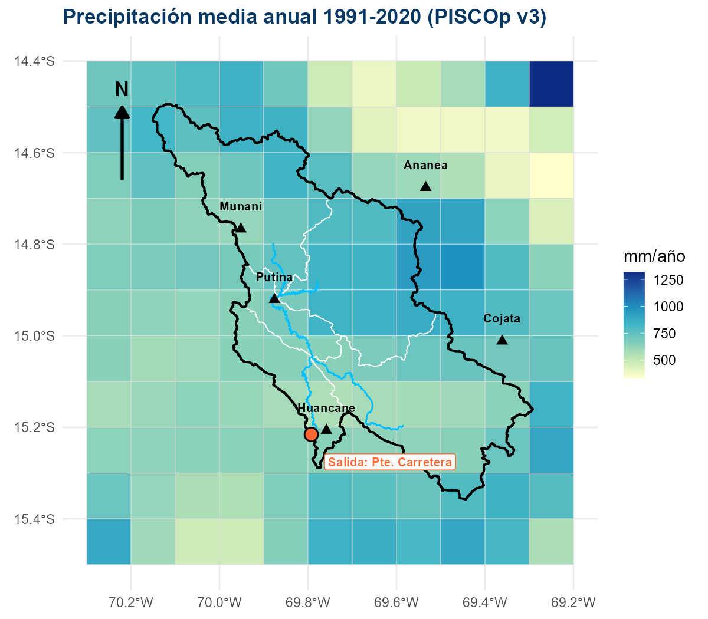{width="100%"}
:::
::::

## Climatología mensual en la cuenca

:::: {.columns}
::: {.column width="46%"}
```r
reg_cuenca <- pp_regimen |>
  crop(cuenca) |>
  mask(cuenca, touches = TRUE)

regimen_df <- reg_cuenca |>
  as.data.frame(xy = TRUE) |>
  pivot_longer(-c(x, y),
    names_to = "mes",
    values_to = "pp")

ggplot(regimen_df) +
  geom_tile(aes(x, y,
                fill = pp)) +
  facet_wrap(~ mes, ncol = 4)
```

::: {.fuente}
Diciembre a marzo concentra el 68 % de la lluvia anual (489 de 716 mm). En julio caen apenas 5 mm.
:::
:::

::: {.column width="54%"}
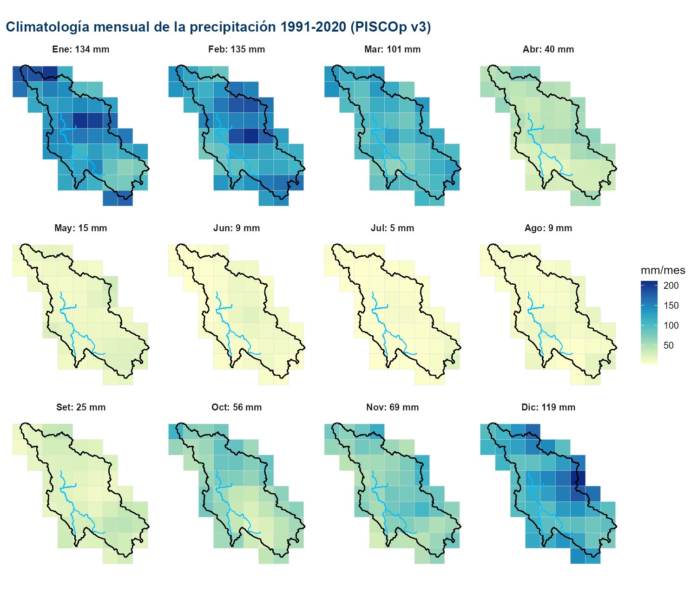{width="100%"}
:::
::::

## Precipitación areal

```r
# Promedio de las celdas, ponderado por la fracción dentro de la cuenca
pp_areal <- extract(pp, cuenca, fun = mean, weights = TRUE,
                    na.rm = TRUE, ID = FALSE)

pp_cuenca_mes <- pp_areal |>
  pivot_longer(everything(), values_to = "pp") |>
  mutate(fecha = fechas)
#> Media anual 1991–2020 de la cuenca: 716 mm
```

. . .

:::: {.columns}
::: {.column width="55%"}
```r
# El mismo código, con las subcuencas
extract(pp_media, subcuencas,
        fun = mean, weights = TRUE)
```
:::

::: {.column width="45%"}
| Subcuenca | Área (km²) | PP (mm/año) |
|:---:|---:|---:|
| 1 | 892 | 737 |
| 2 | 948 | 819 |
| 3 | 231 | 689 |
| 4 | 1106 | 650 |
| 5 | 367 | 619 |
:::
::::

## PISCO frente a la estación

:::: {.columns}
::: {.column width="55%"}
```r
pisco_punto <- extract(pp, huancane_v,
                       ID = FALSE)

comparacion |>
  summarise(
    r     = cor(obs, pisco),
    pbias = 100 * sum(pisco - obs) /
                  sum(obs))
#>       r  pbias
#>   0.950  -4.13
```

::: {.fuente}
413 meses comunes (1981–2025). PISCOp v3 subestima en un 4 % la estación Huancané. Como PISCO **incorpora** las estaciones del SENAMHI, esto no es una validación independiente.
:::
:::

::: {.column width="45%"}
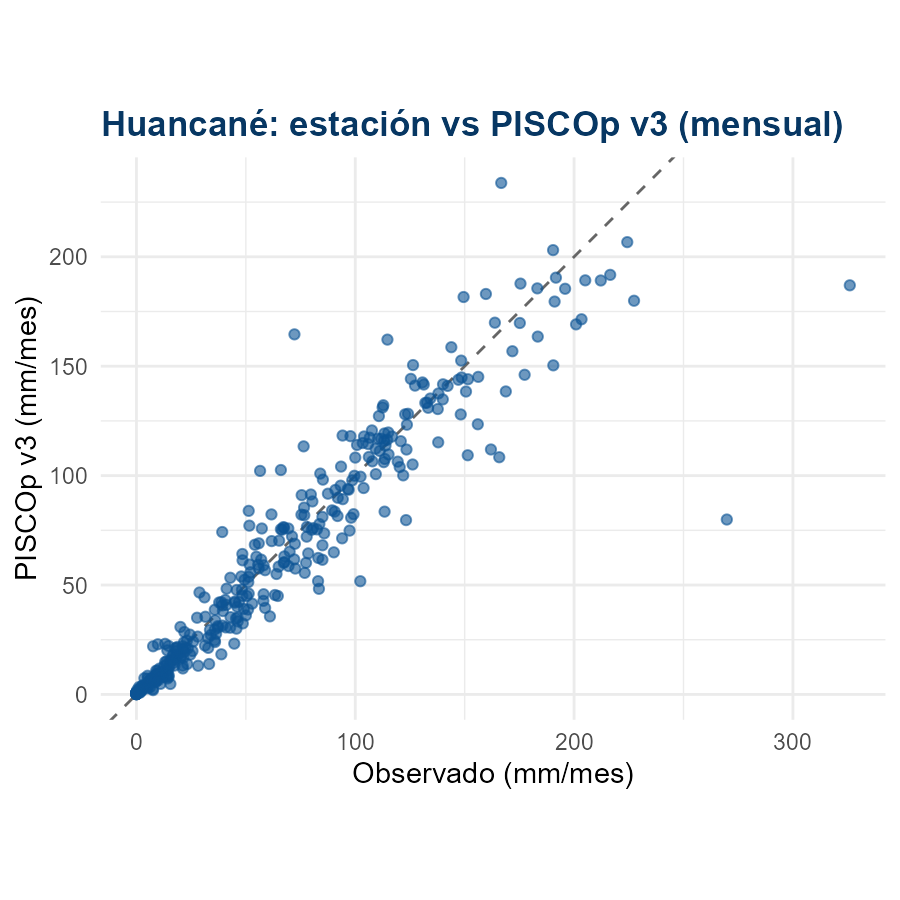{width="100%"}
:::
::::

## Temperatura por subcuenca

```r
tmax <- read_csv("data/temp/Datos_tmax.csv")    # diaria, 1981–2020
tmin <- read_csv("data/temp/Datos_tmin.csv")
#>   Date         Sb1   Sb3   Sb2   Sb5   Sb4
#>   1981-01-01 13.9  15.8  14.0  15.9  14.7
```

. . .

```r
a_largo <- function(datos, nombre) {
  datos |>
    pivot_longer(-Date, names_to = "subcuenca", values_to = nombre) |>
    mutate(subcuenca = parse_number(subcuenca)) |>
    rename(fecha = Date)
}

temp <- inner_join(a_largo(tmax, "tmax"), a_largo(tmin, "tmin"),
                   by = c("fecha", "subcuenca"))
nrow(temp)                          #> 73050 (14610 días × 5)
temp |> filter(tmin > tmax) |> nrow()   #> 0
```

::: {.fuente}
Fuente: PISCO temperatura diaria 1981–2020 (SENAMHI), promediada por subcuenca. Tmax: [doi.org/10.6084/m9.figshare.20522806](https://doi.org/10.6084/m9.figshare.20522806) · Tmin: [doi.org/10.6084/m9.figshare.20533715](https://doi.org/10.6084/m9.figshare.20533715)
:::

## ETP por Hargreaves-Samani
**Comprendiendo la ecuación**

$$ETP = 0.0023 \cdot R_a \cdot (T_{media} + 17.8) \cdot \sqrt{T_{max} - T_{min}}$$

. . .

```r
hargreaves <- function(tmax, tmin, lat, fecha) {
  tmedia <- (tmax + tmin) / 2
  0.0023 * radiacion_ext(lat, fecha) * (tmedia + 17.8) *
    sqrt(pmax(tmax - tmin, 0))
}
```

. . .

```r
etp_dia <- temp |>
  left_join(info_sub, by = "subcuenca") |>        # latitud y área
  mutate(etp = hargreaves(tmax, tmin, lat, fecha))

etp_cuenca_mes <- etp_dia |>
  group_by(subcuenca, area_km2, fecha = floor_date(fecha, "month")) |>
  summarise(etp = sum(etp), .groups = "drop") |>   # diaria -> mensual
  group_by(fecha) |>
  summarise(etp = weighted.mean(etp, area_km2))    # ponderado por área
#> ETP media anual 1981–2020: 1105 mm
```

::: {.fuente}
$R_a$ = radiación extraterrestre (FAO-56), función de la latitud del centroide y del día del año.
:::

## Balance P – ETP

:::: {.columns}
::: {.column width="40%"}
**Unir P y ETP de la cuenca**

```r
balance <- inner_join(
  pp_cuenca_mes,
  etp_cuenca_mes,
  by = "fecha") |>
  filter(year(fecha) %in%
         1991:2020)
```

::: {.fragment .fade-in}
| | mm/año |
|---|---:|
| Precipitación | 716 |
| ETP | 1115 |
| **P / ETP** | **0.64** |
:::
:::

::: {.column width="60%"}
::: {.fragment .fade-in}
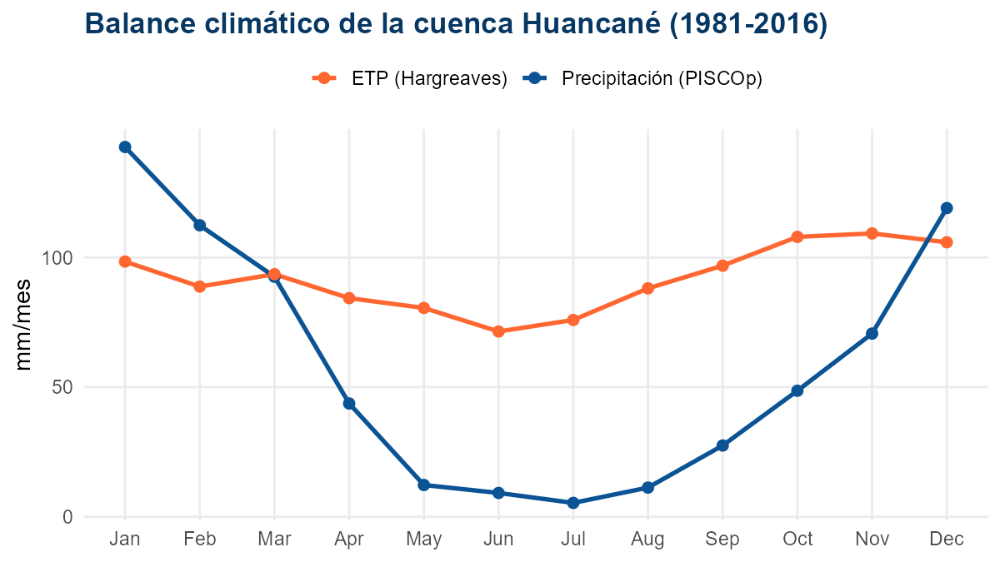{width="100%"}
:::

::: {.fragment .fade-in style="font-size: 0.7em;"}
| P / ETP | Significado |
|:---:|:---|
| **< 1** | Déficit: la ETP supera a la lluvia (más seco) |
| **≈ 1** | Equilibrio entre lluvia y ETP |
| **> 1** | Exceso: la lluvia supera a la ETP (más húmedo) |
:::
:::
::::

::: {.fragment .fade-in}
::: {.fuente}
Normal 1991–2020: P/ETP = 0.64, la cuenca es **deficitaria** en el año. Solo de diciembre a marzo llueve más de lo que se puede evaporar; de abril a noviembre hay déficit.
:::
:::

## Exportar los resultados

```r
# Series mensuales areales: pp 1981–2025, etp 1981–2020
pp_cuenca_mes |>
  left_join(etp_cuenca_mes, by = "fecha") |>
  write_csv("data/processed/PP_ETP_mensual_cuenca.csv")

# Mapa de precipitación media como GeoTIFF (se abre en QGIS)
writeRaster(pp_media, "outputs/PP_media_anual_PISCOv3.tif")
```

. . .

::: {.fuente}
En el Día 2 el modelo **GR4J** trabaja a paso **diario** y por **subcuenca**: usa la misma lluvia PISCOp v3 y la ETP de Hargreaves, pero día a día en cada una de las 5 subcuencas (`data/pcp/` y `data/temp/`).
:::


