## Contenido día 2 {.contenido background-color="#0B5394"}

1.  Cambio climático observado
2.  Escenarios futuros: conceptos
3.  Datos CMIP6 en GEE y corrección de sesgo
4.  Modelamiento I: calibración y validación
5.  Modelamiento II: simulación futura
6.  Cierre

## Cambio climático observado {.seccion background-color="#0B5394"}

::: {.num}
01
:::

Series areales de la cuenca, índices de extremos (ETCCDI) y tendencias (Mann-Kendall y pendiente de Sen)

## Servicios climáticos y Cambio Climático
### ¿Que son los Servicios Climáticos?

Los servicios climáticos consisten en la generación, traducción y entrega de información científica sobre el clima (pasado, presente y futuro) en un formato práctico y comprensible. Su objetivo es ayudar a personas, empresas y gobiernos a tomar mejores decisiones para reducir riesgos y aprovechar oportunidades frente a las condiciones del clima.

### ¿Qué es el cambio climático?

El cambio climático es la variación a largo plazo de las temperaturas y los patrones habituales del clima en la Tierra. Aunque puede tener causas naturales, desde el siglo XIX se debe principalmente a las actividades humanas (como la quema de combustibles fósiles y la deforestación), que aumentan los gases de efecto invernadero y provocan el calentamiento global.

## Series diarias de la cuenca

```r
# Precipitación (PISCOp v3, 1981–2025) y temperatura (PISCO, 1981–2020)
# por subcuenca -> cuenca: promedio ponderado por área
serie_cuenca <- function(archivo, nombre) {
  read_csv(archivo) |>
    pivot_longer(-Date, names_to = "subcuenca", values_to = "valor") |>
    mutate(subcuenca = parse_number(subcuenca)) |>
    left_join(areas, by = "subcuenca") |>
    group_by(fecha = Date) |>
    summarise({{ nombre }} := weighted.mean(valor, area_km2))
}
```

. . .

```r
clima <- serie_cuenca("data/pcp/Datos_pcp.csv",   pp) |>
  left_join(serie_cuenca("data/temp/Datos_tmax.csv", tmax), by = "fecha") |>
  left_join(serie_cuenca("data/temp/Datos_tmin.csv", tmin), by = "fecha")
#>   fecha         pp  tmax  tmin
#>   1981-01-01  6.40  14.5  2.14
```

::: {.fuente}
Las llaves dobles alrededor de `nombre` y el operador `:=` usan el nombre que le pasamos (`pp`, `tmax`, `tmin`) como nombre de la columna nueva.
:::

## Índices de extremos (ETCCDI)

| Índice | Definición | Unidad |
|:---|:---|:---:|
| PRCPTOT | Lluvia total anual en días húmedos (≥ 1 mm) | mm |
| Rx1day / Rx5day | Máxima lluvia en 1 día / en 5 días seguidos | mm |
| SDII | Intensidad: lluvia por día húmedo | mm/día |
| R10mm | Días con lluvia ≥ 10 mm | días |
| CDD / CWD | Racha seca (< 1 mm) / húmeda (≥ 1 mm) más larga | días |
| TX / TN | Tmax / Tmin media anual | °C |
| TXx / TNn | Tmax más alta / Tmin más baja del año | °C |
| FD | Días con helada (Tmin < 0 °C) | días |
| DTR | Rango térmico diario medio (Tmax − Tmin) | °C |

::: {.fuente}
Expert Team on Climate Change Detection and Indices (ETCCDI): 27 índices estándar para comparar regiones y estudios.
:::

## Calcular los índices con `summarise()`

```r
# Racha más larga de TRUE seguidos: rle() cuenta "corridas"
racha_max <- function(condicion) {
  r <- rle(condicion)
  max(c(0, r$lengths[r$values]))
}
racha_max(c(TRUE, TRUE, FALSE, TRUE, TRUE, TRUE))   #> 3
```

. . .

```r
indices_pp <- clima |>
  group_by(anio = year(fecha)) |>
  summarise(PRCPTOT = sum(pp[pp >= 1]),
            Rx1day  = max(pp),
            Rx5day  = max(zoo::rollsum(pp, 5)),
            CDD     = racha_max(pp < 1),
            CWD     = racha_max(pp >= 1))

indices_t <- clima |>
  filter(year(fecha) <= 2020) |>
  group_by(anio = year(fecha)) |>
  summarise(TX = mean(tmax), TN = mean(tmin),
            FD = sum(tmin < 0))                     # días con helada
```

## Anomalías de temperatura

:::: {.columns}
::: {.column width="50%"}
```r
anomalias <- indices |>
  filter(anio <= 2020) |>
  mutate(
    ref = anio %in% 1991:2020,
    anom_TX = TX - mean(TX[ref]),
    anom_TN = TN - mean(TN[ref]))
```

::: {.fuente}
Anomalía = valor del año − media de la normal 1991–2020. De 2013 a 2020 todos los años tienen Tmax sobre la normal. 1983, 1998 y 2016 coinciden con eventos El Niño.
:::
:::

::: {.column width="50%"}
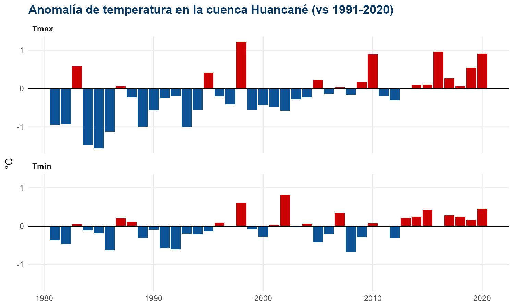{width="100%"}
:::
::::

## Tendencias: Mann-Kendall y Sen

```r
tx <- indices_t$TX            # Tmax media anual, 1981–2020

mk.test(tx)                   # ¿hay tendencia monótona?
#> z = 4.3458, n = 40, p-value = 1.387e-05

sens.slope(tx)                # ¿cuánto cambia por año?
#> Sen's slope 0.0345 °C/año  (IC 95 %: 0.023 a 0.048)
```

. . .

```r
# Series autocorrelacionadas: MK modificado (Hamed y Rao, 1998)
acf(tx, plot = FALSE)$acf[2]  #> 0.27
mmkh(tx)["new P-value"]       #> 1.39e-05
```

. . .

::: {.fuente}
**Mann-Kendall**: prueba no paramétrica, no supone normalidad. **Sen**: mediana de las pendientes entre todos los pares de años, robusta a valores extremos. Tmax sube **+0.35 °C por década**.
:::

## Todas las tendencias con `map()`

:::: {.columns}
::: {.column width="50%"}
```r
tendencia <- function(x) {
  x <- x[!is.na(x)]
  b <- sens.slope(x)$estimates
  tibble(
    sen_decada = b * 10,
    p_mmk = mmkh(x)["new P-value"])
}

resumen <- indices |>
  select(-anio) |>
  map(tendencia) |>
  list_rbind(names_to = "indice")
```
:::

::: {.column width="50%"}
| Índice | Sen /década | p (MMK) |
|:---|---:|---:|
| PRCPTOT | −6.6 mm | 0.66 |
| Rx1day | +0.3 mm | 0.48 |
| CDD | +2.3 días | 0.42 |
| **TX** | **+0.35 °C** | **< 0.001** |
| **TN** | **+0.14 °C** | **0.004** |
| **TXx** | **+0.48 °C** | **< 0.001** |
| **FD** | **−4.5 días** | **0.015** |
| **DTR** | **+0.18 °C** | **0.002** |
:::
::::

## Cambio climático observado en la cuenca

{width="80%" fig-align="center"}

::: {.fuente}
La **precipitación no muestra tendencia** significativa (1981–2025). La **temperatura sí**: la cuenca se calienta y pierde ~4.5 días de helada por década (1981–2020). Tmax sube más rápido que Tmin, por eso el rango térmico (DTR) aumenta.
:::

## Escenarios futuros: conceptos {.seccion background-color="#0B5394"}

::: {.num}
02
:::

CMIP6, escenarios SSP, ensambles de modelos y horizontes temporales

## ¿Qué es un modelo climático global?

:::: {.columns}
::: {.column width="55%"}
- Resuelve las **ecuaciones físicas** de la atmósfera, el océano, el hielo y la superficie terrestre.
- Divide el planeta en una **grilla de 100 a 250 km**: una cuenca como Huancané cabe en una o dos celdas.
- Simula el **clima**, no el tiempo: el año 2030 del modelo no es un pronóstico del año 2030.
- Por eso se comparan **estadísticas de 30 años**, nunca días o años sueltos.
:::

::: {.column width="45%"}
**CMIP6** (Coupled Model Intercomparison Project, fase 6)

- Proyecto internacional que coordina a decenas de centros de modelación.
- Todos corren los **mismos experimentos**: histórico (1850–2014) y escenarios futuros (2015–2100).
- Es la base del 6.º informe del IPCC (AR6, 2021).
:::
::::

::: {.fuente}
Eyring et al. (2016). Overview of the Coupled Model Intercomparison Project Phase 6 (CMIP6). *Geoscientific Model Development*, 9, 1937–1958.
:::

## Escenarios SSP

| Escenario | Narrativa socioeconómica | Forzamiento 2100 |
|:---|:---|:---:|
| SSP1-2.6 | Sostenibilidad: cooperación, energía limpia | 2.6 W/m² |
| **SSP2-4.5** | **Camino intermedio: las tendencias actuales continúan** | **4.5 W/m²** |
| SSP3-7.0 | Rivalidad regional: poca cooperación, alto crecimiento poblacional | 7.0 W/m² |
| SSP5-8.5 | Desarrollo basado en combustibles fósiles | 8.5 W/m² |

. . .

::: {.fuente}
**SSP** (Shared Socioeconomic Pathway) describe *cómo* evoluciona la sociedad; el número es el **forzamiento radiativo** al 2100, que resume *cuánto* se calienta el planeta. En el curso usamos **SSP2-4.5** por tiempo: es el escenario intermedio y el más usado en estudios de adaptación.
:::

## ¿Cuánto se calienta el planeta?

{width="92%" fig-align="center"}

::: {.fuente}
Hasta 2040 todos los escenarios llegan a ~1.5 °C: la diferencia entre escenarios aparece **después de 2050**. IPCC (2021), AR6 WG1, Resumen para responsables de políticas, Tabla SPM.1.
:::

## De la grilla global a la cuenca

:::: {.columns}
::: {.column width="55%"}
**NEX-GDDP-CMIP6** (NASA)

- 35 modelos CMIP6 **reducidos de escala** a 0.25° (~27 km).
- Datos **diarios**: precipitación, Tmax, Tmin y otras variables.
- Histórico 1950–2014 y escenarios SSP 2015–2100.
- Disponible en **Google Earth Engine**: `NASA/GDDP-CMIP6`.
:::

::: {.column width="45%"}
- Método BCSD: corrige el sesgo contra un **producto global** de referencia.
- Una celda de 0.25° cubre ~730 km²: la cuenca Huancané (3542 km²) tiene unas **5 celdas**.
- Que esté corregido a escala global **no** significa que coincida con PISCO: hay que volver a corregir con datos locales (bloque 03).
:::
::::

::: {.fuente}
Thrasher et al. (2022). NASA Global Daily Downscaled Projections, CMIP6. *Scientific Data*, 9, 262.
:::

## Ensambles: ¿por qué varios modelos?

:::: {.columns}
::: {.column width="42%"}
**Tres fuentes de incertidumbre**

| Fuente | Cómo se aborda |
|:---|:---|
| Escenario | Varios SSP |
| Modelo | Varios GCM (ensamble) |
| Variabilidad natural | Periodos de 30 años |
:::

::: {.column width="58%"}
**Ensamble del curso (SSP2-4.5)**

| Modelo | Centro (país) |
|:---|:---|
| ACCESS&#8209;CM2 | CSIRO-ARCCSS (Australia) |
| MIROC6 | JAMSTEC / AORI / NIES (Japón) |
| MPI&#8209;ESM1&#8209;2&#8209;HR | Max Planck (Alemania) |
:::
::::

::: {.fuente}
Cada modelo representa de forma distinta los procesos físicos: su **dispersión** es una medida de la incertidumbre. Tres modelos es un mínimo didáctico; los estudios usan 5 a 10 o más. Hawkins y Sutton (2009), *Bulletin of the American Meteorological Society*, 90, 1095–1108.
:::

## Horizontes y periodos

{width="85%" fig-align="center"}

::: {.fuente}
**Referencia** 1985–2014: los últimos 30 años del histórico de CMIP6, que también cubren PISCO. **Futuro cercano** 2020–2049: el horizonte útil para planificar obras y adaptación. Cambio = futuro − referencia, **del mismo modelo**.
:::

## Lo que trae un modelo sin corregir

{width="78%" fig-align="center"}

::: {.fuente}
En 1985–2014 los modelos dan una Tmax **~2 °C más alta** y una lluvia **6–10 % mayor** que PISCO. Tampoco reproducen años concretos (1983 seco, 1984 húmedo), y no deben hacerlo. Antes de usarlos hay que **corregir el sesgo**.
:::

## Datos CMIP6 en GEE y corrección de sesgo {.seccion background-color="#0B5394"}

::: {.num}
03
:::

Descarga en Google Earth Engine, mapeo de cuantiles (qmap) vs. método delta y señales de cambio

## Descarga en Google Earth Engine

:::: {.columns}
::: {.column width="58%"}
```javascript
var coleccion = ee.ImageCollection(
    'NASA/GDDP-CMIP6')
  .filter(ee.Filter.eq('model', modelo))
  .filter(ee.Filter.inList('scenario',
          ['historical', 'ssp245']))
  .filterDate('1981-01-01', '2050-01-01')
  .select(['pr', 'tasmax', 'tasmin'])
  .map(convertir);   // a mm/día y °C

// Promedio de cada día en cada subcuenca
img.reduceRegions({
  collection: cuenca.select(['Subbasin']),
  reducer: ee.Reducer.mean(),
  scale: 1000
});

Export.table.toDrive({ ... fileFormat: 'CSV' });
```
:::

::: {.column width="42%"}
- Script: `ejercicios/Descarga_CMIP6_GEE.js`, se ejecuta en [code.earthengine.google.com](https://code.earthengine.google.com).
- Una tarea por modelo; el CSV llega a Google Drive.
- Resultado: una fila por **día y subcuenca**, 1981–2049.
- Lo mismo se puede hacer desde R con el paquete **rgee**.
:::
::::

::: {.fuente}
El campo de la subcuenca (`Subbasin`) debe existir en el asset: si el nombre no coincide, la columna llega vacía y sin error.
:::

## Leer los tres modelos

```r
archivos <- list.files("data/cmip6", pattern = "ssp245\\.csv$",
                       full.names = TRUE)

cmip <- archivos |>
  map(\(f) read_csv(f, show_col_types = FALSE)) |>
  list_rbind() |>
  transmute(fecha = Fecha, subcuenca = Subcuenca, modelo = Modelo,
            pp = Pr_mm, tmax = Tmax, tmin = Tmin)

count(cmip, modelo)
#>   ACCESS-CM2    126010
#>   MIROC6        126010
#>   MPI-ESM1-2-HR 126010     (5 subcuencas x 25202 días)
```

::: {.fuente}
`map()` + `list_rbind()`: el mismo patrón del Día 1 para leer varias estaciones.
:::

## ¿Cuánto sesgo tienen?

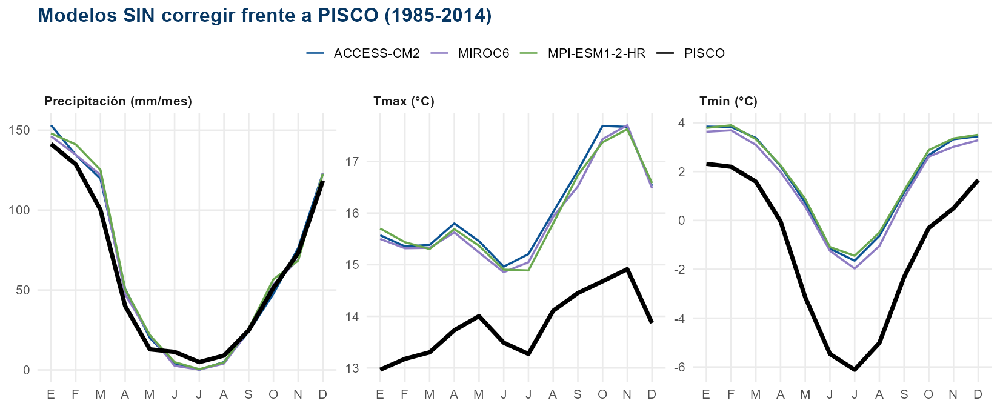{width="92%" fig-align="center"}

::: {.fuente}
Sesgo anual de la cuenca, 1985–2014: lluvia **+4.6 a +7.6 %**, Tmax **+2.1 a +2.2 °C** y Tmin **+2.7 a +3.0 °C**. La lluvia tiene la forma correcta; la temperatura está desplazada en todos los meses, más en la Tmin del invierno.
:::

## Dos formas de corregir

| | Método delta | Mapeo de cuantiles |
|:---|:---|:---|
| **Qué usa del modelo** | Solo el **cambio** entre sus periodos | Toda la serie diaria |
| **Serie futura** | Lo observado, perturbado mes a mes | El modelo corregido |
| **Corrige** | La media mensual | Toda la distribución (medias, extremos, días secos) |
| **Variabilidad futura** | La misma de 1985–2014 | La del modelo |
| **Ventaja** | Simple, robusto | Conserva la secuencia de años del modelo |

. . .

::: {.fuente}
Delta: P~fut~ = P~obs~ × (P~mod,fut~ / P~mod,ref~) y T~fut~ = T~obs~ + (T~mod,fut~ − T~mod,ref~), para cada mes y subcuenca.
:::

## Método delta

```r
deltas <- inner_join(regimen(cmip, ref, cuenca = FALSE),
                     regimen(cmip, fut, cuenca = FALSE),
                     by = c("modelo", "subcuenca", "mes"),
                     suffix = c("_ref", "_fut")) |>
  transmute(modelo, subcuenca, mes,
            f_pp   = pp_fut / pp_ref,          # razón
            d_tmax = tmax_fut - tmax_ref,      # diferencia
            d_tmin = tmin_fut - tmin_ref)
#>   ACCESS-CM2, subcuenca 1:   mes  f_pp  d_tmax  d_tmin
#>                                1  1.00    1.61    1.36
#>                                3  1.19    1.56    1.23
```

. . .

```r
fut_delta <- obs |>
  filter(year(fecha) %in% ref) |>
  mutate(mes = month(fecha)) |>
  inner_join(deltas, by = c("subcuenca", "mes")) |>
  mutate(pp = pp * f_pp, tmax = tmax + d_tmax, tmin = tmin + d_tmin)
```

## Mapeo de cuantiles: un caso

:::: {.columns}
::: {.column width="50%"}
```r
# Subcuenca 1, febrero, ACCESS-CM2
ajuste <- fitQmap(o, m_ref,
                  method  = "QUANT",
                  wet.day = TRUE,
                  qstep   = 0.01)
m_cor <- doQmap(m_ref, ajuste)
```

| | Media | P95 | Días secos |
|:---|:---:|:---:|:---:|
| PISCO | 4.52 | 12.3 | 3.8 % |
| Modelo | 5.04 | 11.8 | 5.5 % |
| Corregido | 4.54 | 12.1 | 4.1 % |
:::

::: {.column width="50%"}
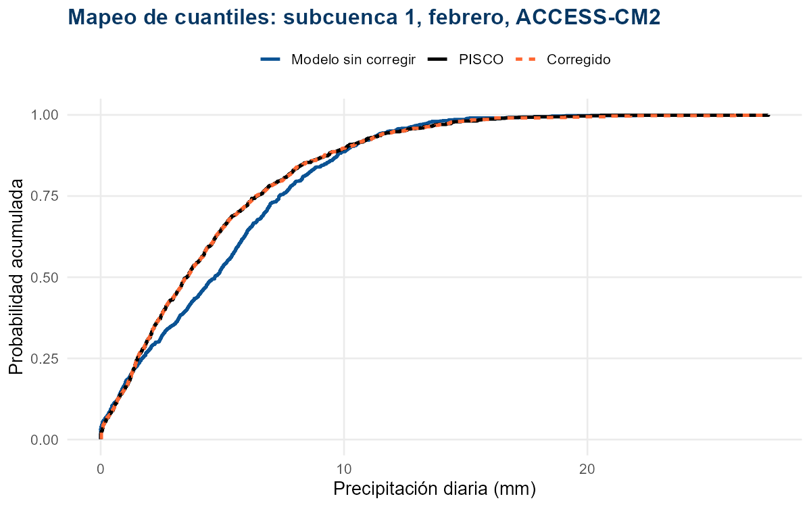{width="100%"}
:::
::::

::: {.fuente}
Cada valor del modelo se reemplaza por el valor observado **del mismo cuantil**. `wet.day = TRUE` corrige además la frecuencia de días con lluvia. Cargar `qmap` **antes** que `tidyverse`: su dependencia MASS tiene otra `select()`.
:::

## Todos los casos con `nest()` y `pmap()`

```r
corregir <- function(o, m, variable) {
  m_ref  <- m$valor[year(m$fecha) %in% ref]        # ajuste en 1985-2014
  ajuste <- fitQmap(o$valor, m_ref, method = "QUANT",
                    wet.day = variable == "pp")
  tibble(fecha = m$fecha, valor = doQmap(m$valor, ajuste))  # aplica 1981-2049
}

cmip_qm <- cmip |>
  pivot_longer(c(pp, tmax, tmin), names_to = "variable", values_to = "valor") |>
  mutate(mes = month(fecha)) |>
  nest(m = c(fecha, valor)) |>                     # 540 grupos
  left_join(obs_mes, by = c("subcuenca", "variable", "mes")) |>
  mutate(cor = pmap(list(o, m, variable), corregir)) |>
  select(modelo, subcuenca, variable, cor) |>
  unnest(cor) |>
  pivot_wider(names_from = variable, values_from = valor)
```

::: {.fuente}
3 modelos × 5 subcuencas × 3 variables × 12 meses = 540 ajustes en ~20 segundos. Control: ningún día con Tmin ≥ Tmax.
:::

## ¿Funcionó la corrección?

{width="90%" fig-align="center"}

::: {.fuente}
Después de corregir, los tres modelos reproducen el régimen de PISCO en 1985–2014: lluvia 720–723 mm (PISCO 716), Tmax 13.8 °C y Tmin −1.2 °C. Las líneas quedan una sobre otra.
:::

## Señales de cambio: 2020–2049 frente a 1985–2014

| Variable | Método | ACCESS-CM2 | MIROC6 | MPI-ESM1-2-HR |
|:---|:---|:---:|:---:|:---:|
| Lluvia | Sin corregir | +1.2 % | +8.3 % | +9.5 % |
| | Delta | +1.2 % | +7.7 % | +9.8 % |
| | Cuantiles | +2.1 % | +6.8 % | +8.2 % |
| Tmax | Sin corregir y delta | +1.51 °C | +1.15 °C | +0.92 °C |
| | Cuantiles | +1.20 °C | +0.85 °C | +0.64 °C |
| Tmin | Sin corregir y delta | +1.32 °C | +0.91 °C | +0.94 °C |
| | Cuantiles | +1.22 °C | +0.95 °C | +0.80 °C |

. . .

::: {.fuente}
Los tres modelos coinciden: **más calor** (+0.6 a +1.5 °C) y **algo más de lluvia** (+1 a +10 %). El método delta conserva la señal del modelo; el mapeo de cuantiles la **modifica**, sobre todo en Tmax (ejercicio E3). Ensamble (cuantiles): +5.7 % de lluvia, +0.9 °C Tmax, +1.0 °C Tmin.
:::

## Señal mensual

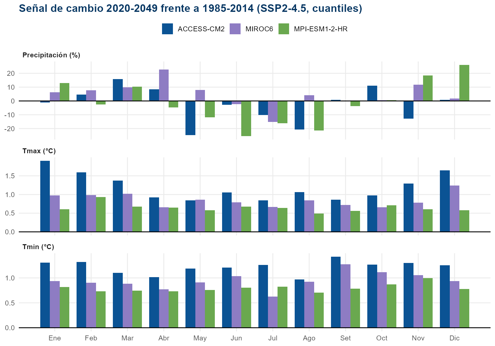{width="72%" fig-align="center"}

## Series corregidas de la cuenca

{width="80%" fig-align="center"}

::: {.fuente}
Estas series diarias por subcuenca (`data/processed/CMIP6_QM_subcuencas.csv`) son la entrada del modelo GR4J en el bloque 05.
:::

## Modelamiento I {.seccion background-color="#0B5394"}

::: {.num}
04
:::

Modelo GR4J semidistribuido con airGRiwrm: red de subcuencas, calibración y validación

## Introducción al modelo GR4J {.smaller}

:::: {.columns}
::: {.column width="58%"}
::: {.fragment .fade-in}

**Conceptos generales**

- Modelo **conceptual** de lluvia-escorrentía, de paso **diario**, con solo **4 parámetros** libres ($X_1$ a $X_4$).
- Desarrollado por Perrin (2001) a partir del modelo pionero GR3J (Edijatno y Michel, 1989).
- **Validación global**: evaluado en 429 cuencas de climas muy distintos, incluidos climas tropicales.
- **Desempeño**: superó a modelos clásicos como TOPMODEL, Tank, IHACRES, HBV y SMAR (Perrin et al., 2003).
- Entradas: precipitación ($P$) y evapotranspiración potencial ($E$). Salida: caudal ($Q$).

:::
:::

::: {.column width="42%"}
::: {.fragment .fade-in}

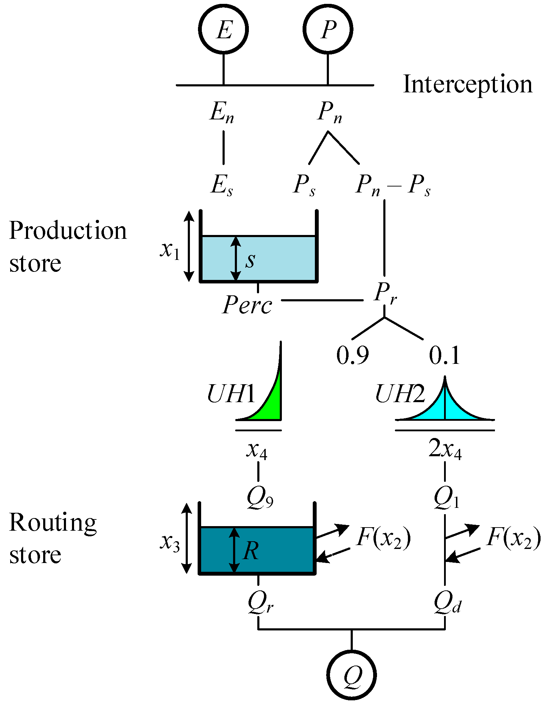{height="560px" fig-align="center"}

:::
:::
::::

## Parámetros del GR4J {.smaller}

:::: {.columns}
::: {.column width="58%"}

::: {style="font-size: 0.68em;"}
| | Parámetro | Qué representa |
|:--|:---|:---|
| $X_1$ | Reservorio de **producción** (mm) | El suelo: reparte la lluvia entre ETP, almacenamiento y percolación. Suelos más profundos → mayor $X_1$. |
| $X_2$ | **Intercambio** subterráneo (mm/día) | $X_2 < 0$: la cuenca pierde agua hacia el acuífero; $X_2 > 0$: la gana. |
| $X_3$ | Reservorio de **tránsito** (mm) | Retención del agua: controla la recesión y el caudal base. |
| $X_4$ | Tiempo base del **UH1** (días) | Rapidez de la respuesta; UH2 dura $2X_4$. |
:::

::: {.fuente}
La lluvia efectiva se reparte siempre en **90 %** por UH1 hacia el reservorio de tránsito (flujo lento) y **10 %** por UH2 directo al río (flujo rápido): ese reparto es fijo, no es un parámetro.
:::

:::

::: {.column width="42%"}

{height="560px" fig-align="center"}

:::
::::

## ¿Por qué semidistribuido?

{width="78%" fig-align="center"}

::: {.fuente}
La lluvia cambia entre **636 y 819 mm/año** según la subcuenca. Un modelo agregado la promedia; **airGRiwrm** corre GR4J en cada subcuenca y suma los caudales a lo largo del río. Ejercicio: `ejercicios/07_Modelamiento_GR4J.R`.
:::

## La red sale de la tabla de ríos

:::: {.columns}
::: {.column width="56%"}
```r
red <- tramos |>
  mutate(
    id   = as.character(Subbasin),
    down = as.character(SubbasinR),
    down = na_if(down, "0")) |>
  transmute(
    id, down,
    length = largo_km[match(down, id)],
    area   = AreaC / 100,  # km²
    model  = if_else(is.na(down),
                     "RunModel_GR4J",
                     "Ungauged"))

griwrm <- CreateGRiwrm(red)
```

::: {.fuente}
`area` es el área **acumulada** en el nodo. Solo la salida tiene estación: las otras 4 subcuencas son `Ungauged` y heredan los parámetros de la 5.
:::
:::

::: {.column width="44%"}
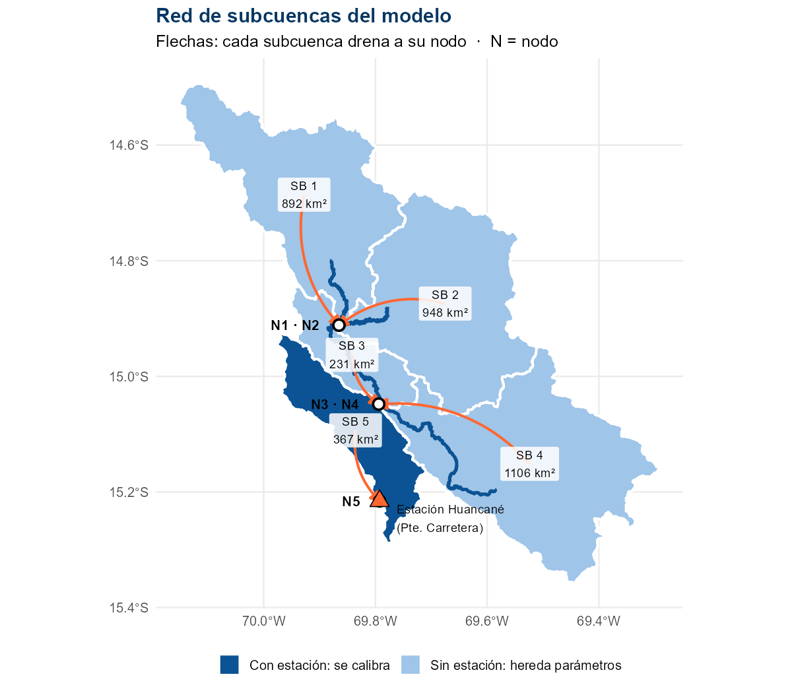{width="100%"}
:::
::::

## Esquema de la red

{width="92%" fig-align="center"}

::: {.fuente}
`plot(griwrm)` dibuja este esquema con el servicio en línea mermaid.ink (requiere internet). En el script lo construimos con `ggplot2`.
:::

## Entradas del modelo

```r
# Una fila por día, una columna por nodo (mismo orden que la red)
P   <- a_matriz(forzantes, "pp")    #> 14610 x 5  (1981-2020)
ETP <- a_matriz(forzantes, "etp")   # Hargreaves, como en el Día 1

# GR4J trabaja en lámina: m³/s -> mm/día
Qobs <- cbind("5" = q_obs$q * 86.4 / area_salida)

InputsModel <- CreateInputsModel(griwrm,
                                 DatesR  = as.POSIXct(fechas, tz = "UTC"),
                                 Precip  = P,
                                 PotEvap = ETP)
```

. . .

| Periodo | Años | Uso |
|:---|:---:|:---|
| Calentamiento | 1981–1983 | llenar los reservorios del modelo |
| Calibración | 1984–2004 | ajustar los parámetros |
| Validación | 2005–2019 | evaluar con datos que el modelo no vio |

## Calibración con KGE

:::: {.columns}
::: {.column width="66%"}
```r
InputsCrit <- CreateInputsCrit(
  InputsModel,
  FUN_CRIT   = ErrorCrit_KGE2,
  RunOptions = RunOptions_cal,
  Obs        = Qobs[i_cal, , drop = FALSE])

CalibOptions <- CreateCalibOptions(InputsModel)
OutputsCalib <- Calibration(
  InputsModel, RunOptions_cal,
  InputsCrit, CalibOptions)
#> Crit. KGE2[Q] = 0.8563     (~2 minutos)

Param <- extractParam(OutputsCalib)
```
:::

::: {.column width="34%"}
| Parámetro | Valor |
|:---|---:|
| X1 (mm) | 47.6 |
| X2 (mm/d) | 0.32 |
| X3 (mm) | 203.5 |
| X4 (d) | 1.64 |

::: {.fuente}
X1 producción, X2 intercambio con acuíferos, X3 tránsito, X4 tiempo base del hidrograma unitario. Las subcuencas sin estación reciben X1–X3 iguales; X4 se ajusta por el área: 1.43 a 2.28 días (Lobligeois, 2014).
:::
:::
::::

## Desempeño del modelo

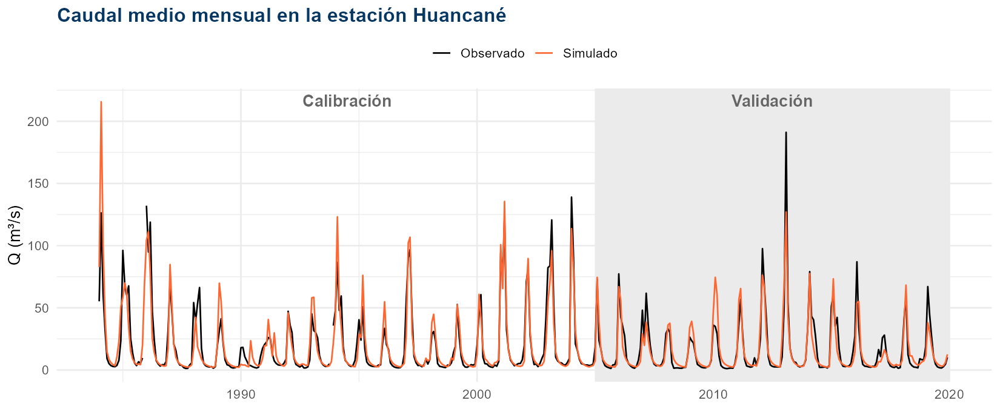{width="82%" fig-align="center"}

| Periodo | KGE | NSE | r | PBIAS | Q obs (m³/s) | Q sim (m³/s) |
|:---|:---:|:---:|:---:|:---:|:---:|:---:|
| Calibración | 0.86 | 0.71 | 0.86 | +0.3 % | 20.2 | 20.2 |
| Validación | 0.81 | 0.76 | 0.87 | −4.1 % | 16.2 | 15.6 |

## Régimen mensual

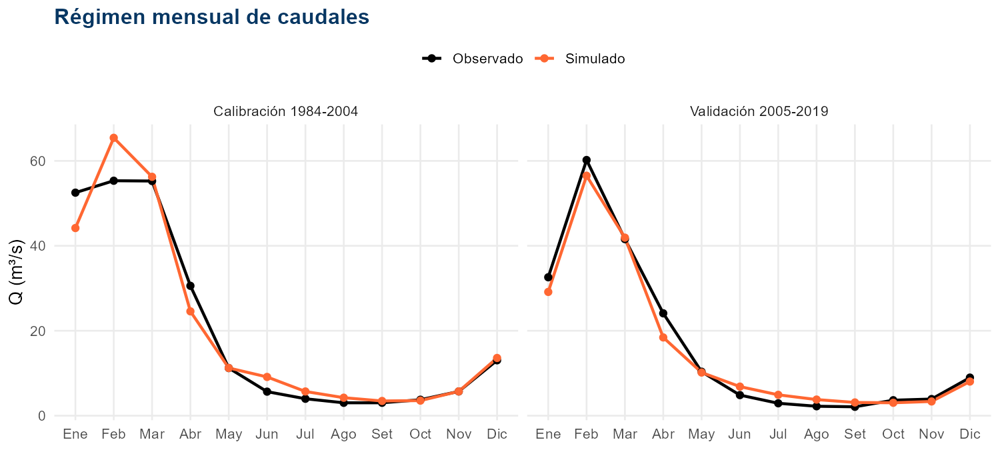{width="90%" fig-align="center"}

::: {.fuente}
El modelo reproduce la época de lluvias (diciembre a abril) y la recesión. En los meses secos simula algo más de caudal que el observado.
:::

## Un año de validación, día a día

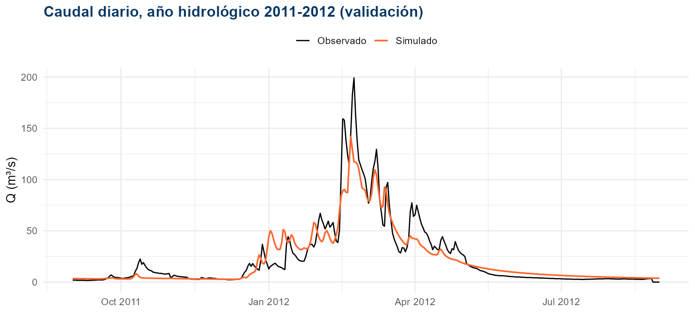{width="90%" fig-align="center"}

::: {.fuente}
Año hidrológico 2011–2012: el pico de febrero (~200 m³/s) se subestima, pero la forma de la crecida y la recesión siguen bien al caudal observado.
:::

## Curva de duración

:::: {.columns}
::: {.column width="58%"}
{width="100%"}
:::

::: {.column width="42%"}
- Crecidas y caudales medios: **bien representados**.
- Estiaje (más del 50 % del tiempo): el modelo **sobrestima**, ~2.5 m³/s simulados frente a ~1.5 m³/s observados.
- El KGE da más peso a los caudales altos. Para estiajes: `transfo = "sqrt"` o `"log"` en `CreateInputsCrit()` (ejercicio E2).
:::
::::

## Cómo se arma el caudal en la red

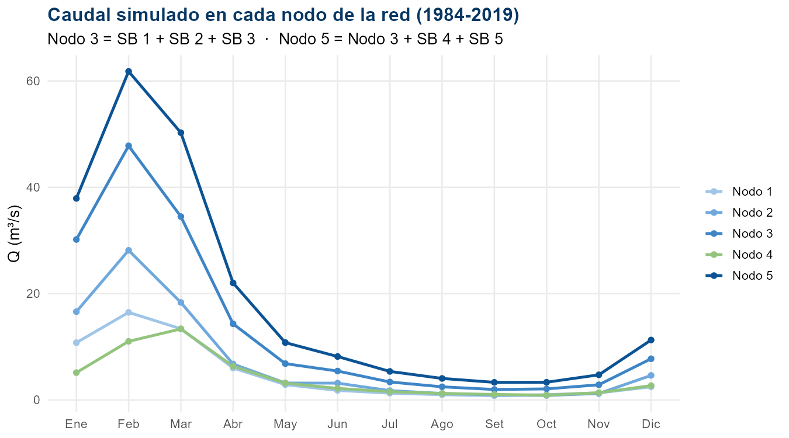{width="78%" fig-align="center"}

::: {.fuente}
El modelo entrega caudal en **todos los nodos**, también donde no hay estación. Con airGRiwrm se pueden agregar extracciones de riego, trasvases o embalses en cualquier nodo.
:::

## Modelamiento II {.seccion background-color="#0B5394"}

::: {.num}
05
:::

Simulación futura (SSP2-4.5) y comparación del régimen de caudales

## El mismo modelo, otro clima

- Se usa el GR4J **calibrado** en el bloque 04 (`outputs/modelo_GR4J_Huancane.rds`): los parámetros no cambian.
- Solo cambian los **forzantes**: lluvia corregida y ETP de Hargreaves con las temperaturas corregidas.
- Cuantiles: una corrida por modelo, de 1981 a 2049; referencia y futuro salen **de la misma corrida**.
- Delta: referencia = PISCO observado; futuro = PISCO perturbado.

. . .

::: {.fuente}
Supuesto fuerte: la cuenca responde en el futuro igual que en 1984–2004 (mismos parámetros, mismo uso del suelo). Es la práctica habitual, pero hay que decirlo.
:::

## Una función para simular cualquier clima

```r
simular <- function(forzantes, anios_warmup = 3) {
  f <- forzantes |>
    left_join(latitudes, by = "subcuenca") |>
    mutate(etp = hargreaves(tmax, tmin, lat, fecha))
  # ... matrices de pp y etp con a_matriz() (columnas en el orden de griwrm)
  InputsModel <- CreateInputsModel(griwrm, DatesR = fechas,
                                   Precip = a_matriz("pp"),
                                   PotEvap = a_matriz("etp"))
  RunOptions <- CreateRunOptions(InputsModel, IndPeriod_WarmUp = ...,
                                 IndPeriod_Run = ...)
  salida <- RunModel(InputsModel, RunOptions, Param)
  tibble(fecha = ..., q = attr(salida, "Qm3s")[["5"]])
}

q_qm <- cmip_qm |>
  nest(forzantes = -modelo) |>              # un clima por modelo
  mutate(q = map(forzantes, simular)) |>
  unnest(q)
```

## Lluvia: cambio por subcuenca

{width="100%" fig-align="center"}

::: {.fuente}
Los tres modelos dan **más lluvia** en todas las subcuencas, pero con distinta intensidad: de +0.6 % (ACCESS-CM2) a +13 % (MPI-ESM1-2-HR). El mayor aumento está en la subcuenca 3, en el centro de la cuenca.
:::

## Evapotranspiración: cambio por subcuenca

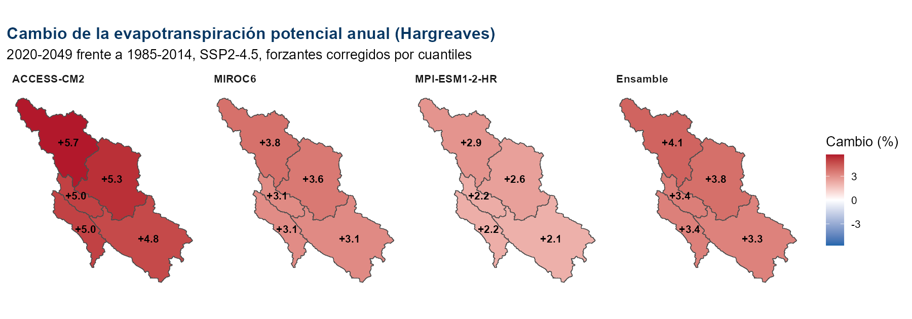{width="100%" fig-align="center"}

::: {.fuente}
La ETP sube en todos los casos (+2 a +6 %), más en la cabecera (subcuenca 1). El modelo que más calienta (ACCESS-CM2, ETP ~+5 %) es el que menos lluvia agrega (~+1 %): por eso es el único con **menos caudal** en el futuro.
:::

## Caudal: cambio por tramo de río

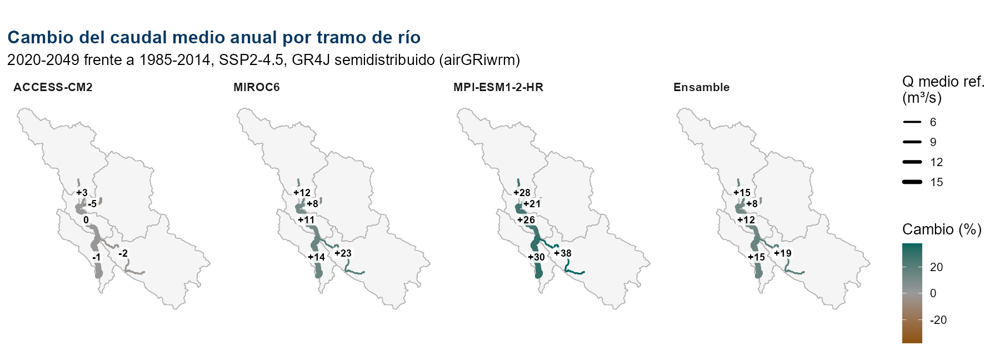{width="100%" fig-align="center"}

```r
q_nodos <- cmip_qm |>
  nest(forzantes = -modelo) |>
  mutate(q = map(forzantes, \(f) simular(f, nodos = griwrm$id))) |>
  unnest(q)                                  # caudal en los 5 nodos
```

::: {.fuente}
El caudal responde más que la lluvia y no igual en todos los tramos: en el tramo 4 la lluvia sube +7 a +8 % (MIROC6, MPI) y el caudal +23 a +38 %. Con ACCESS-CM2 el tramo 2 pierde caudal (−5 %) porque la ETP (+5 %) crece más que la lluvia (+1 %).
:::

## Régimen de caudales: referencia y futuro

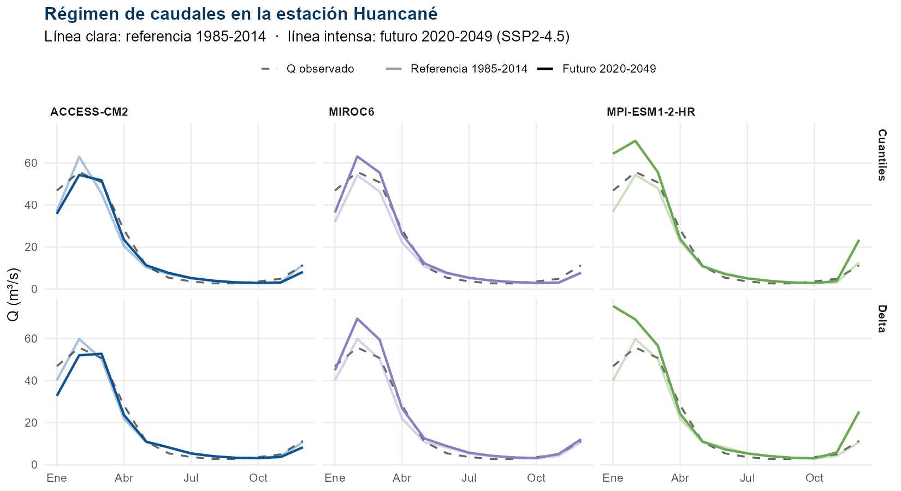{width="90%" fig-align="center"}

## ¿Cuánto cambia el caudal?

| Modelo | Método | Q medio | Lluvias (dic–mar) | Estiaje (jun–set) |
|:---|:---|:---:|:---:|:---:|
| ACCESS-CM2 | Cuantiles | −1.1 % | −4.1 % | +3.8 % |
| | Delta | −6.1 % | −9.2 % | −0.5 % |
| MIROC6 | Cuantiles | +14.5 % | +15.8 % | +3.9 % |
| | Delta | +15.3 % | +15.5 % | +6.3 % |
| MPI-ESM1-2-HR | Cuantiles | +30.1 % | +41.2 % | −3.1 % |
| | Delta | +31.1 % | +41.6 % | −4.2 % |

. . .

::: {.fuente}
Lluvia +1 a +10 % → caudal −6 a +31 %: el caudal **amplifica** el cambio de la lluvia, y más calor (más ETP) no alcanza a compensarlo. Los dos métodos dan el mismo orden de magnitud; la **diferencia entre modelos** es mucho mayor que la diferencia entre métodos.
:::

## Cambio mes a mes

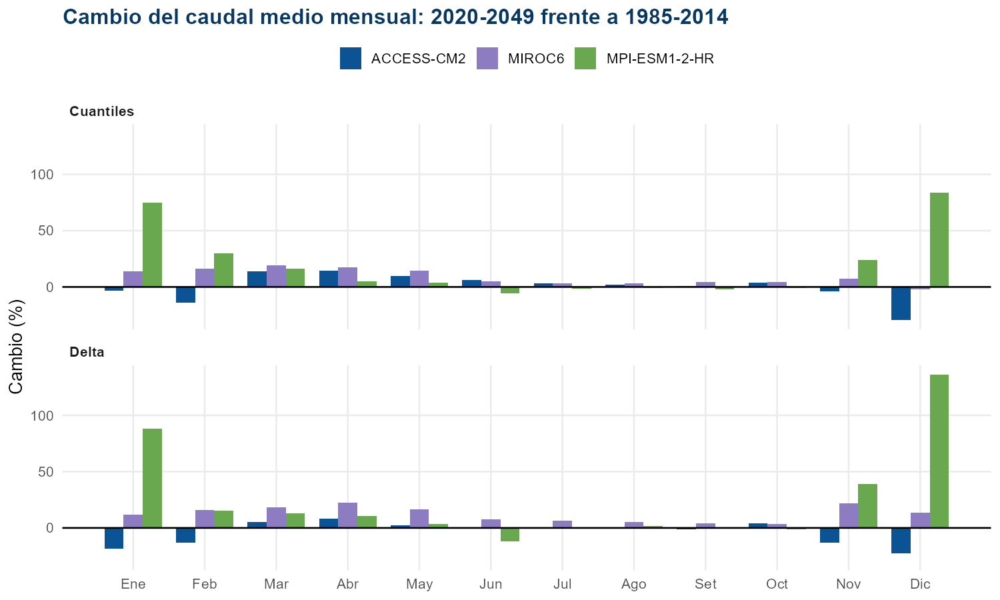{width="78%" fig-align="center"}

::: {.fuente}
El cambio se concentra en **dic–ene**, el inicio de la época de lluvias. En estiaje los cambios son pequeños (±6 %).
:::

## Curva de duración

:::: {.columns}
::: {.column width="56%"}
{width="100%"}
:::

::: {.column width="44%"}
| | Q10 | Q50 | Q90 |
|:---|:---:|:---:|:---:|
| ACCESS | 46→47 | 6.2→6.2 | 2.6→2.7 |
| MIROC6 | 46→52 | 6.4→6.7 | 2.7→2.8 |
| MPI | 48→67 | 6.0→6.9 | 2.6→2.6 |

m³/s, referencia → futuro
:::
::::

::: {.fuente}
Los caudales **altos** (Q10) son los que más cambian; los caudales bajos (Q90) casi no se mueven.
:::

## ¿Qué le decimos al usuario del agua?

- **Temperatura**: señal clara y coherente entre modelos: +0.6 a +1.5 °C hacia 2020–2049.
- **Lluvia y caudal**: los tres modelos van de "sin cambio" a "+30 % de caudal medio": la **incertidumbre** es mayor que la señal.
- El estiaje casi no cambia en ningún caso: buena noticia para la oferta en época seca, pero con solo 3 modelos.
- Un servicio climático no da **un** número: da un **rango** y explica de dónde sale.

. . .

::: {.fuente}
Para un estudio real: más modelos (≥ 10), más escenarios (SSP1-2.6, SSP3-7.0, SSP5-8.5), otros horizontes (2050–2079) y, si se puede, más de un modelo hidrológico.
:::

## Cierre {.seccion background-color="#0B5394"}

::: {.num}
06
:::

R + Python, recursos y rutas de continuación
