## Contenido día 2 {.contenido background-color="#0B5394"}

1.  Cambio climático observado
2.  Escenarios futuros: conceptos
3.  Datos CMIP6 en GEE y corrección de sesgo
4.  Modelamiento I: calibración y validación
5.  Modelamiento II: simulación futura
6.  Cierre

## Cambio climático observado {.seccion background-color="#0B5394"}

::: {.num}
01
:::

Series areales de la cuenca, índices de extremos (ETCCDI) y tendencias (Mann-Kendall y pendiente de Sen)

## Servicios climáticos y Cambio Climático
### ¿Que son los Servicios Climáticos?

Los servicios climáticos consisten en la generación, traducción y entrega de información científica sobre el clima (pasado, presente y futuro) en un formato práctico y comprensible. Su objetivo es ayudar a personas, empresas y gobiernos a tomar mejores decisiones para reducir riesgos y aprovechar oportunidades frente a las condiciones del clima.

### ¿Qué es el cambio climático?

El cambio climático es la variación a largo plazo de las temperaturas y los patrones habituales del clima en la Tierra. Aunque puede tener causas naturales, desde el siglo XIX se debe principalmente a las actividades humanas (como la quema de combustibles fósiles y la deforestación), que aumentan los gases de efecto invernadero y provocan el calentamiento global.

## Cambio climático en el altiplano

En los Andes y el altiplano (cuenca del lago Titicaca), el cambio climático afecta directamente la disponibilidad de agua y los medios de vida.

:::: {.columns style="font-size: 0.8em"}
::: {.column width="33%"}
**Glaciares y agua**

- Los glaciares tropicales pierden hielo con rapidez: menos reserva de agua para ríos y lagunas en época seca.
- Más evaporación por el aumento de temperatura: menos agua en ríos, bofedales y lagos.
- El deshielo forma o agranda lagunas glaciares: riesgo de aluviones y desbordes.
:::

::: {.column width="33%"}
**Lluvia y temperatura**

- Inicio de lluvias irregular y tormentas intensas en pocos días: inundaciones y erosión.
- Periodos secos largos: menos agua para consumo, riego y pastos.
- Aunque sube la temperatura media, heladas fuera de época y granizadas siguen dañando los cultivos.
:::

::: {.column width="33%"}
**Agricultura y ganadería**

- Papa, quinua, cebada y habas: pérdidas por estrés hídrico, heladas tardías o exceso de humedad.
- Plagas y enfermedades llegan a zonas más altas, donde antes no sobrevivían.
- Bofedales degradados: menos alimento y agua para alpacas, llamas, ovinos y vacunos.
:::
::::

::: {.fuente}
Los glaciares andinos perdieron entre 30 % y más del 50 % de su área desde los años 80 (IPCC AR6 GTII, cap. 12). Fuentes: Castellanos et al. (2022), *Central and South America*, IPCC AR6 GTII, cap. 12 — [ipcc.ch/report/ar6/wg2/chapter/chapter-12](https://www.ipcc.ch/report/ar6/wg2/chapter/chapter-12/) · Rabatel et al. (2013), *The Cryosphere* 7, 81–102, [doi:10.5194/tc-7-81-2013](https://doi.org/10.5194/tc-7-81-2013).
:::

## Series diarias de la cuenca

```r
# Precipitación (PISCOp v3, 1981–2025) y temperatura (PISCO, 1981–2020)
# por subcuenca -> cuenca: promedio ponderado por área
serie_cuenca <- function(archivo, nombre) {
  read_csv(archivo) |>
    pivot_longer(-Date, names_to = "subcuenca", values_to = "valor") |>
    mutate(subcuenca = parse_number(subcuenca)) |>
    left_join(areas, by = "subcuenca") |>
    group_by(fecha = Date) |>
    summarise({{ nombre }} := weighted.mean(valor, area_km2))
}
```

. . .

```r
clima <- serie_cuenca("data/pcp/Datos_pcp.csv",   pp) |>
  left_join(serie_cuenca("data/temp/Datos_tmax.csv", tmax), by = "fecha") |>
  left_join(serie_cuenca("data/temp/Datos_tmin.csv", tmin), by = "fecha")
#>   fecha         pp  tmax  tmin
#>   1981-01-01  6.40  14.5  2.14
```

::: {.fuente}
Las llaves dobles alrededor de `nombre` y el operador `:=` usan el nombre que le pasamos (`pp`, `tmax`, `tmin`) como nombre de la columna nueva.
:::

## ¿De dónde salen los índices ETCCDI?

:::: {.columns}
::: {.column style="width: 55%; font-size: 0.8em"}
- **ETCCDI**: *Expert Team on Climate Change Detection and Indices*, equipo conjunto de la OMM (Comisión de Climatología), el WCRP (CLIVAR) y la JCOMM, creado tras el taller CLIVAR/GCOS/OMM de 1998 (Karl et al., 1999).
- Definió **27 índices básicos** calculados con datos **diarios** de lluvia y temperatura (Peterson et al., 2001; Zhang et al., 2011).
- **El problema que resuelven**: muchos países no comparten sus datos diarios, pero sí pueden compartir índices calculados **con la misma fórmula** → se comparan regiones y estudios.
- Describen extremos **moderados** (ocurren varias veces al año), no eventos de 100 años → hay suficientes casos para detectar **tendencias**.
:::

::: {.column style="width: 45%; font-size: 0.8em"}
**Cinco tipos de índices**

| Tipo | Ejemplos |
|:---|:---|
| Absolutos | Rx1day, Rx5day, TXx, TNn |
| Umbral fijo | FD, R10mm, SU |
| Percentiles | TX90p, TN10p, R95p |
| Duración | CDD, CWD, WSDI |
| Otros | PRCPTOT, SDII, DTR |

Software: RClimDex, `climdex.pcic` (R), ClimPACT. Base de los capítulos de extremos del IPCC (AR6, cap. 11).
:::
::::

::: {.fuente}
Karl, Nicholls y Ghazi (1999), *Climatic Change* 42, 3–7 · Peterson et al. (2001), WMO-TD 1071 · Zhang et al. (2011), *WIREs Climate Change* 2, 851–870, [doi:10.1002/wcc.147](https://doi.org/10.1002/wcc.147) · Lista oficial: [etccdi.pacificclimate.org/list_27_indices.shtml](https://etccdi.pacificclimate.org/list_27_indices.shtml)
:::

## Índices de extremos (ETCCDI)

::: {style="font-size: 0.8em"}
| Índice | Definición | Tipo | Unidad |
|:-------------|:--------------------------------------------|:---------|:------:|
| PRCPTOT | Lluvia total anual en días húmedos (≥ 1 mm) | Otros | mm |
| Rx1day / Rx5day | Máxima lluvia en 1 día / en 5 días seguidos | Absoluto | mm |
| SDII | Intensidad: lluvia por día húmedo | Otros | mm/día |
| R10mm | Días con lluvia ≥ 10 mm | Umbral | días |
| CDD / CWD | Racha seca (< 1 mm) / húmeda (≥ 1 mm) más larga | Duración | días |
| TX / TN | Tmax / Tmin media anual | ET-SCI\* | °C |
| TXx / TNn | Tmax más alta / Tmin más baja del año | Absoluto | °C |
| FD | Días con helada (Tmin < 0 °C) | Umbral | días |
| DTR | Rango térmico diario medio (Tmax − Tmin) | Otros | °C |
:::

::: {.fuente}
\* TX y TN no están entre los 27 del ETCCDI: los agregó su sucesor, el ET-SCI (*Expert Team on Sector-specific Climate Indices*), en ClimPACT como TXm y TNm ([climpact-sci.org/indices](https://climpact-sci.org/indices/)). Un "día húmedo" es el que tiene ≥ 1 mm.
:::

## Calcular los índices con `summarise()`

```r
# Racha más larga de TRUE seguidos: rle() cuenta "corridas"
racha_max <- function(condicion) {
  r <- rle(condicion)
  max(c(0, r$lengths[r$values]))
}
racha_max(c(TRUE, TRUE, FALSE, TRUE, TRUE, TRUE))   #> 3
```

. . .

```r
indices_pp <- clima |>
  group_by(anio = year(fecha)) |>
  summarise(PRCPTOT = sum(pp[pp >= 1]),
            Rx1day  = max(pp),
            Rx5day  = max(zoo::rollsum(pp, 5)),
            CDD     = racha_max(pp < 1),
            CWD     = racha_max(pp >= 1))

indices_t <- clima |>
  filter(year(fecha) <= 2020) |>
  group_by(anio = year(fecha)) |>
  summarise(TX = mean(tmax), TN = mean(tmin),
            FD = sum(tmin < 0))                     # días con helada
```

## Anomalías de temperatura

:::: {.columns}
::: {.column width="50%"}
```r
anomalias <- indices |>
  filter(anio <= 2020) |>
  mutate(
    ref = anio %in% 1991:2020,
    anom_TX = TX - mean(TX[ref]),
    anom_TN = TN - mean(TN[ref]))
```

::: {.fuente}
Anomalía = valor del año − media de la normal 1991–2020. De 2013 a 2020 todos los años tienen Tmax sobre la normal. 1983, 1998 y 2016 coinciden con eventos El Niño.
:::
:::

::: {.column width="50%"}
{width="100%"}
:::
::::

## Tendencias: Mann-Kendall y Sen

```r
tx <- indices_t$TX            # Tmax media anual, 1981–2020

mk.test(tx)                   # ¿hay tendencia monótona?
#> z = 4.3458, n = 40, p-value = 1.387e-05

sens.slope(tx)                # ¿cuánto cambia por año?
#> Sen's slope 0.0345 °C/año  (IC 95 %: 0.023 a 0.048)
```

. . .

```r
# Series autocorrelacionadas: MK modificado (Hamed y Rao, 1998)
acf(tx, plot = FALSE)$acf[2]  #> 0.27
mmkh(tx)["new P-value"]       #> 1.39e-05
```

. . .

::: {.fuente}
**Mann-Kendall**: prueba no paramétrica, no supone normalidad. **Sen**: mediana de las pendientes entre todos los pares de años, robusta a valores extremos. Tmax sube **+0.35 °C por década**.
:::

## Todas las tendencias con `map()`

:::: {.columns}
::: {.column width="50%"}
```r
tendencia <- function(x) {
  x <- x[!is.na(x)]
  b <- sens.slope(x)$estimates
  tibble(
    sen_decada = b * 10,
    p_mmk = mmkh(x)["new P-value"])
}

resumen <- indices |>
  select(-anio) |>
  map(tendencia) |>
  list_rbind(names_to = "indice")
```
:::

::: {.column width="50%"}
| Índice | Sen /década | p (MMK) |
|:---|---:|---:|
| PRCPTOT | −6.6 mm | 0.66 |
| Rx1day | +0.3 mm | 0.48 |
| CDD | +2.3 días | 0.42 |
| **TX** | **+0.35 °C** | **< 0.001** |
| **TN** | **+0.14 °C** | **0.004** |
| **TXx** | **+0.48 °C** | **< 0.001** |
| **FD** | **−4.5 días** | **0.015** |
| **DTR** | **+0.18 °C** | **0.002** |
:::
::::

## Cambio climático observado en la cuenca

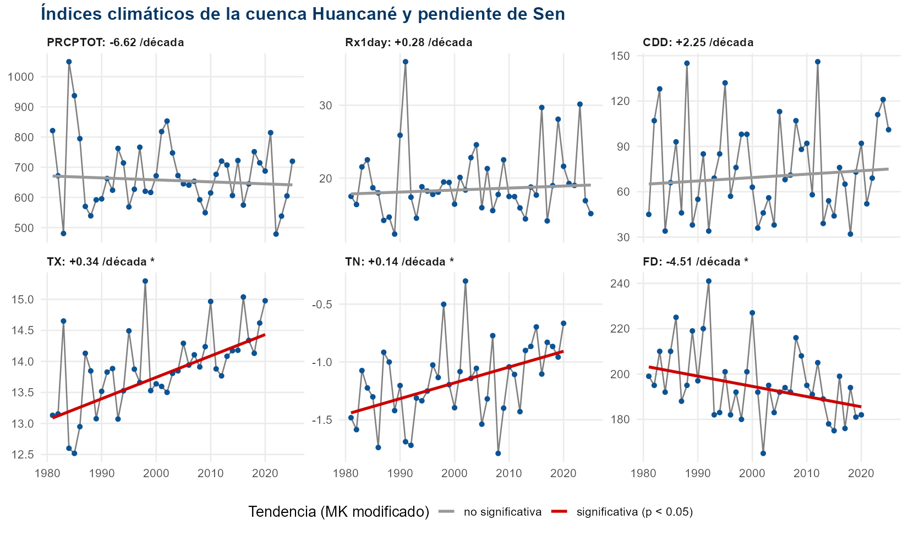{width="80%" fig-align="center"}

::: {.fuente}
La **precipitación no muestra tendencia** significativa (1981–2025). La **temperatura sí**: la cuenca se calienta y pierde ~4.5 días de helada por década (1981–2020). Tmax sube más rápido que Tmin, por eso el rango térmico (DTR) aumenta.
:::

## Escenarios futuros: conceptos {.seccion background-color="#0B5394"}

::: {.num}
02
:::

CMIP6, escenarios SSP, ensambles de modelos y horizontes temporales

## ¿Qué es un modelo climático global?

:::: {.columns}
::: {.column width="55%"}
- Resuelve las **ecuaciones físicas** de la atmósfera, el océano, el hielo y la superficie terrestre.
- Divide el planeta en una **grilla de 100 a 250 km**: una cuenca como Huancané cabe en una o dos celdas.
- Simula el **clima**, no el tiempo: el año 2030 del modelo no es un pronóstico del año 2030.
- Por eso se comparan **estadísticas de periodos largos** (idealmente 30 años), nunca días o años sueltos.
:::

::: {.column width="45%"}
**CMIP6** (Coupled Model Intercomparison Project, fase 6)

- Proyecto internacional que coordina a decenas de centros de modelación.
- Todos corren los **mismos experimentos**: histórico (1850–2014) y escenarios futuros (2015–2100).
- Es la base del 6.º informe del IPCC (AR6, 2021).
:::
::::

::: {.fuente}
Eyring et al. (2016). Overview of the Coupled Model Intercomparison Project Phase 6 (CMIP6). *Geoscientific Model Development*, 9, 1937–1958.
:::

## Escenarios SSP

| Escenario | Narrativa socioeconómica | Forzamiento 2100 |
|:---|:---|:---:|
| SSP1-2.6 | Sostenibilidad: cooperación, energía limpia | 2.6 W/m² |
| **SSP2-4.5** | **Camino intermedio: las tendencias actuales continúan** | **4.5 W/m²** |
| SSP3-7.0 | Rivalidad regional: poca cooperación, alto crecimiento poblacional | 7.0 W/m² |
| SSP5-8.5 | Desarrollo basado en combustibles fósiles | 8.5 W/m² |

. . .

::: {.fuente}
**SSP** (Shared Socioeconomic Pathway) describe *cómo* evoluciona la sociedad; el número es el **forzamiento radiativo** al 2100, que resume *cuánto* se calienta el planeta. En el curso usamos **SSP2-4.5** por tiempo: es el escenario intermedio y el más usado en estudios de adaptación.
:::

## ¿Cuánto se calienta el planeta?

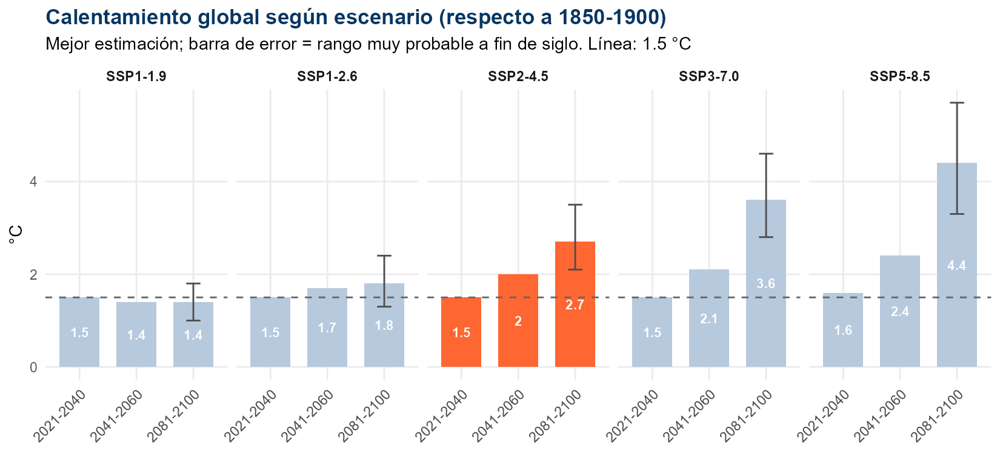{width="92%" fig-align="center"}

::: {.fuente}
Hasta 2040 todos los escenarios llegan a ~1.5 °C: la diferencia entre escenarios aparece **después de 2050**. IPCC (2021), AR6 WG1, Resumen para responsables de políticas, Tabla SPM.1.
:::

## De la grilla global a la cuenca

:::: {.columns}
::: {.column width="55%"}
**NEX-GDDP-CMIP6** (NASA)

- 35 modelos CMIP6 **reducidos de escala** a 0.25° (~27 km).
- Datos **diarios**: precipitación, Tmax, Tmin y otras variables.
- Histórico 1950–2014 y escenarios SSP 2015–2100.
- Disponible en **Google Earth Engine**: `NASA/GDDP-CMIP6`.
:::

::: {.column width="45%"}
- Método BCSD: corrige el sesgo contra un **producto global** de referencia.
- Una celda de 0.25° cubre ~730 km²: la cuenca Huancané (3542 km²) tiene unas **5 celdas**.
- Que esté corregido a escala global **no** significa que coincida con PISCO: hay que volver a corregir con datos locales (bloque 03).
:::
::::

::: {.fuente}
Thrasher et al. (2022). NASA Global Daily Downscaled Projections, CMIP6. *Scientific Data*, 9, 262.
:::

## Ensambles: ¿por qué varios modelos?

:::: {.columns}
::: {.column width="42%"}
**Tres fuentes de incertidumbre**

| Fuente | Cómo se aborda |
|:---|:---|
| Escenario | Varios SSP |
| Modelo | Varios GCM (ensamble) |
| Variabilidad natural | Periodos largos (20–30 años) |
:::

::: {.column width="58%"}
**Ensamble del curso (SSP2-4.5)**

| Modelo | Centro (país) |
|:---|:---|
| ACCESS&#8209;CM2 | CSIRO-ARCCSS (Australia) |
| MIROC6 | JAMSTEC / AORI / NIES (Japón) |
| MPI&#8209;ESM1&#8209;2&#8209;HR | Max Planck (Alemania) |
:::
::::

::: {.fuente}
Cada modelo representa de forma distinta los procesos físicos: su **dispersión** es una medida de la incertidumbre. Tres modelos es un mínimo didáctico; los estudios usan 5 a 10 o más. Hawkins y Sutton (2009), *Bulletin of the American Meteorological Society*, 90, 1095–1108.
:::

## Horizontes y periodos

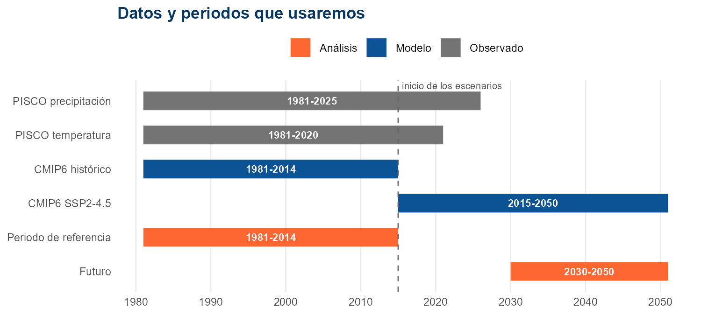{width="85%" fig-align="center"}

::: {.fuente}
**Referencia** 1981–2014: todo el histórico de CMIP6 que también cubre PISCO (34 años). **Futuro** 2030–2050 (21 años, porque los datos llegan a 2050; lo ideal son 30): el horizonte útil para planificar obras y adaptación. Cambio = futuro − referencia, **del mismo modelo**.
:::

## Lo que trae un modelo sin corregir

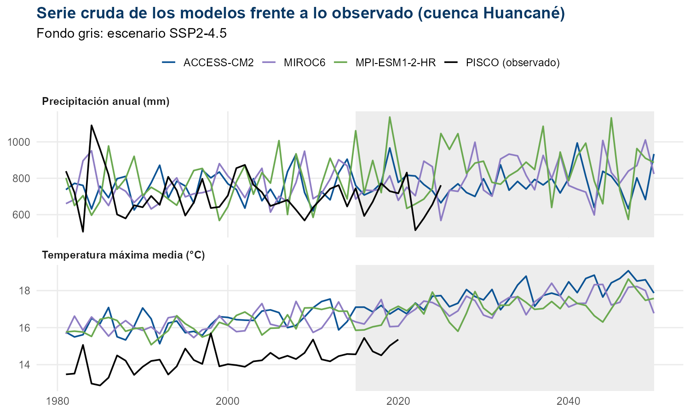{width="78%" fig-align="center"}

::: {.fuente}
En 1981–2014 los modelos dan una Tmax **~2 °C más alta** y una lluvia **5–7 % mayor** que PISCO. Tampoco reproducen años concretos (1983 seco, 1984 húmedo), y no deben hacerlo. Antes de usarlos hay que **corregir el sesgo**.
:::

## Datos CMIP6 en GEE y corrección de sesgo {.seccion background-color="#0B5394"}

::: {.num}
03
:::

Descarga en Google Earth Engine, mapeo de cuantiles (qmap) vs. método delta y señales de cambio

## Descarga en Google Earth Engine

:::: {.columns}
::: {.column width="58%"}
```javascript
var coleccion = ee.ImageCollection(
    'NASA/GDDP-CMIP6')
  .filter(ee.Filter.eq('model', modelo))
  .filter(ee.Filter.inList('scenario',
          ['historical', 'ssp245']))
  .filterDate('1981-01-01', '2051-01-01')
  .select(['pr', 'tasmax', 'tasmin'])
  .map(convertir);   // a mm/día y °C

// Promedio de cada día en cada subcuenca
img.reduceRegions({
  collection: cuenca.select(['Subbasin']),
  reducer: ee.Reducer.mean(),
  scale: 1000
});

Export.table.toDrive({ ... fileFormat: 'CSV' });
```
:::

::: {.column width="42%"}
- Script: `ejercicios/Descarga_CMIP6_GEE.js`, se ejecuta en [code.earthengine.google.com](https://code.earthengine.google.com).
- Una tarea por modelo; el CSV llega a Google Drive.
- Resultado: una fila por **día y subcuenca**, 1981–2050.
- Lo mismo se puede hacer desde R con el paquete **rgee**.
:::
::::

::: {.fuente}
El campo de la subcuenca (`Subbasin`) debe existir en el asset: si el nombre no coincide, la columna llega vacía y sin error.
:::

## Leer los tres modelos

```r
archivos <- list.files("data/cmip6", pattern = "ssp245\\.csv$",
                       full.names = TRUE)

cmip <- archivos |>
  map(\(f) read_csv(f, show_col_types = FALSE)) |>
  list_rbind() |>
  transmute(fecha = Fecha, subcuenca = Subcuenca, modelo = Modelo,
            pp = Pr_mm, tmax = Tmax, tmin = Tmin)

count(cmip, modelo)
#>   ACCESS-CM2    127835
#>   MIROC6        127835
#>   MPI-ESM1-2-HR 127835     (5 subcuencas x 25567 días)
```

::: {.fuente}
`map()` + `list_rbind()`: el mismo patrón del Día 1 para leer varias estaciones.
:::

## ¿Cuánto sesgo tienen?

{width="92%" fig-align="center"}

::: {.fuente}
Sesgo anual de la cuenca, 1981–2014: lluvia **+4.1 a +5.0 %**, Tmax **+2.1 a +2.2 °C** y Tmin **+2.7 a +3.0 °C**. La lluvia tiene la forma correcta; la temperatura está desplazada en todos los meses, más en la Tmin del invierno.
:::

## Dos formas de corregir

| | Método delta | Mapeo de cuantiles |
|:---|:---|:---|
| **Qué usa del modelo** | Solo el **cambio** entre sus periodos | Toda la serie diaria |
| **Serie futura** | Lo observado, perturbado mes a mes | El modelo corregido |
| **Corrige** | La media mensual | Toda la distribución (medias, extremos, días secos) |
| **Variabilidad futura** | La misma de 1981–2014 | La del modelo |
| **Ventaja** | Simple, robusto | Conserva la secuencia de años del modelo |

. . .

::: {.fuente}
Delta: P~fut~ = P~obs~ × (P~mod,fut~ / P~mod,ref~) y T~fut~ = T~obs~ + (T~mod,fut~ − T~mod,ref~), para cada mes y subcuenca.
:::

## Método delta: la idea {.nostretch}

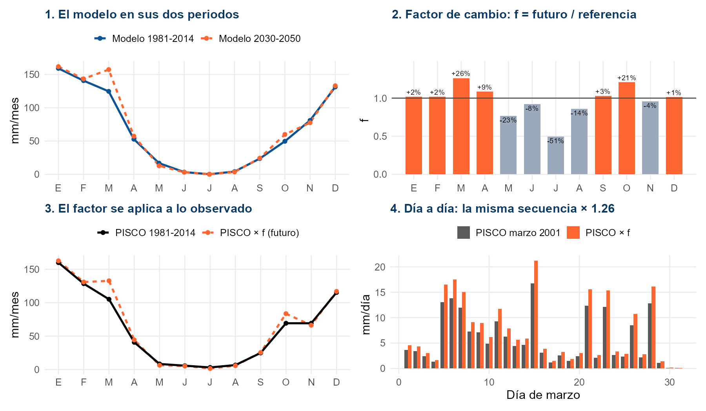{width="72%" fig-align="center"}

::: {.fuente}
El modelo **solo aporta el cambio** (2): su sesgo se cancela en la razón (marzo: modelo 125 mm, PISCO 105 mm; solo importa que sube 26 %). El futuro es **lo observado escalado** (3, 4). En temperatura se **suma** la diferencia (enero: +1.9 °C). Subcuenca 1, ACCESS-CM2.
:::

## Método delta en R

```r
deltas <- inner_join(regimen(cmip, ref, cuenca = FALSE),
                     regimen(cmip, fut, cuenca = FALSE),
                     by = c("modelo", "subcuenca", "mes"),
                     suffix = c("_ref", "_fut")) |>
  transmute(modelo, subcuenca, mes,
            f_pp   = pp_fut / pp_ref,          # razón
            d_tmax = tmax_fut - tmax_ref,      # diferencia
            d_tmin = tmin_fut - tmin_ref)
#>   ACCESS-CM2, subcuenca 1:   mes  f_pp  d_tmax  d_tmin
#>                                1  1.02    1.86    1.73
#>                                3  1.26    1.76    1.43
```

. . .

```r
fut_delta <- obs |>
  filter(year(fecha) %in% ref) |>
  mutate(mes = month(fecha)) |>
  inner_join(deltas, by = c("subcuenca", "mes")) |>
  mutate(pp = pp * f_pp, tmax = tmax + d_tmax, tmin = tmin + d_tmin)
```

## Mapeo de cuantiles: la idea {.nostretch}

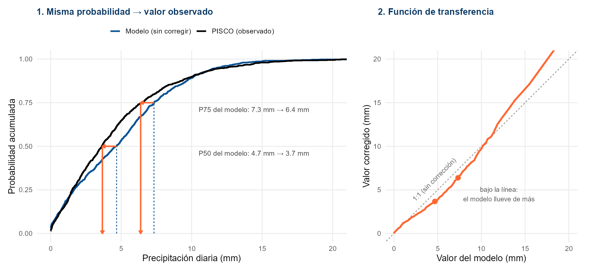{width="92%" fig-align="center"}

::: {.fuente}
Para cada valor del modelo: (1) se busca su **probabilidad** en la curva del modelo y (2) se reemplaza por el valor de PISCO con **la misma probabilidad**. La mediana del modelo (4.7 mm) pasa a 3.7 mm. La función de transferencia se ajusta en 1981–2014 y se aplica a **toda** la serie, futuro incluido. Subcuenca 1, febrero, ACCESS-CM2.
:::

## Mapeo de cuantiles: un caso

:::: {.columns}
::: {.column width="50%"}
```r
# Subcuenca 1, febrero, ACCESS-CM2
ajuste <- fitQmap(o, m_ref,
                  method  = "QUANT",
                  wet.day = TRUE,
                  qstep   = 0.01)
m_cor <- doQmap(m_ref, ajuste)
```

| | Media | P95 | Días secos |
|:---|:---:|:---:|:---:|
| PISCO | 4.55 | 12.3 | 3.7 % |
| Modelo | 4.99 | 11.8 | 5.7 % |
| Corregido | 4.57 | 12.4 | 4.0 % |
:::

::: {.column width="50%"}
{width="100%"}
:::
::::

::: {.fuente}
Cada valor del modelo se reemplaza por el valor observado **del mismo cuantil**. `wet.day = TRUE` corrige además la frecuencia de días con lluvia. Cargar `qmap` **antes** que `tidyverse`: su dependencia MASS tiene otra `select()`.
:::

## Todos los casos con `nest()` y `pmap()`

```r
corregir <- function(o, m, variable) {
  m_ref  <- m$valor[year(m$fecha) %in% ref]        # ajuste en 1981-2014
  ajuste <- fitQmap(o$valor, m_ref, method = "QUANT",
                    wet.day = variable == "pp")
  tibble(fecha = m$fecha, valor = doQmap(m$valor, ajuste))  # aplica 1981-2050
}

cmip_qm <- cmip |>
  pivot_longer(c(pp, tmax, tmin), names_to = "variable", values_to = "valor") |>
  mutate(mes = month(fecha)) |>
  nest(m = c(fecha, valor)) |>                     # 540 grupos
  left_join(obs_mes, by = c("subcuenca", "variable", "mes")) |>
  mutate(cor = pmap(list(o, m, variable), corregir)) |>
  select(modelo, subcuenca, variable, cor) |>
  unnest(cor) |>
  pivot_wider(names_from = variable, values_from = valor)
```

::: {.fuente}
3 modelos × 5 subcuencas × 3 variables × 12 meses = 540 ajustes en ~20 segundos. Control: ningún día con Tmin ≥ Tmax.
:::

## ¿Funcionó la corrección?

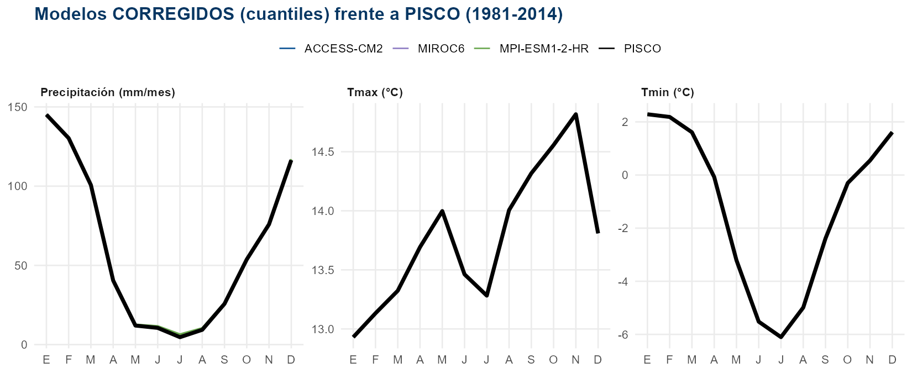{width="90%" fig-align="center"}

::: {.fuente}
Después de corregir, los tres modelos reproducen el régimen de PISCO en 1981–2014: lluvia 729–732 mm (PISCO 725), Tmax 13.8 °C y Tmin −1.2 °C. Las líneas quedan una sobre otra.
:::

## Señales de cambio al 2030–2050

| Variable | Método | ACCESS-CM2 | MIROC6 | MPI-ESM1-2-HR |
|:---|:---|:---:|:---:|:---:|
| Lluvia | Sin corregir | +3.8 % | +9.8 % | +11.5 % |
| | Delta | +3.4 % | +9.6 % | +12.6 % |
| | Cuantiles | +4.7 % | +8.4 % | +9.9 % |
| Tmax | Sin corregir y delta | +1.81 °C | +1.30 °C | +1.09 °C |
| | Cuantiles | +1.44 °C | +0.98 °C | +0.78 °C |
| Tmin | Sin corregir y delta | +1.62 °C | +1.09 °C | +1.11 °C |
| | Cuantiles | +1.48 °C | +1.12 °C | +0.94 °C |

. . .

::: {.fuente}
Cambio respecto a 1981–2014. Los tres modelos coinciden: **más calor** (+0.8 a +1.8 °C) y **algo más de lluvia** (+3 a +13 %). El método delta conserva la señal del modelo; el mapeo de cuantiles la **modifica**, sobre todo en Tmax (ejercicio E3). Ensamble (cuantiles): +7.7 % de lluvia, +1.1 °C Tmax, +1.2 °C Tmin.
:::

## Señal mensual

{width="72%" fig-align="center"}

## Series corregidas de la cuenca

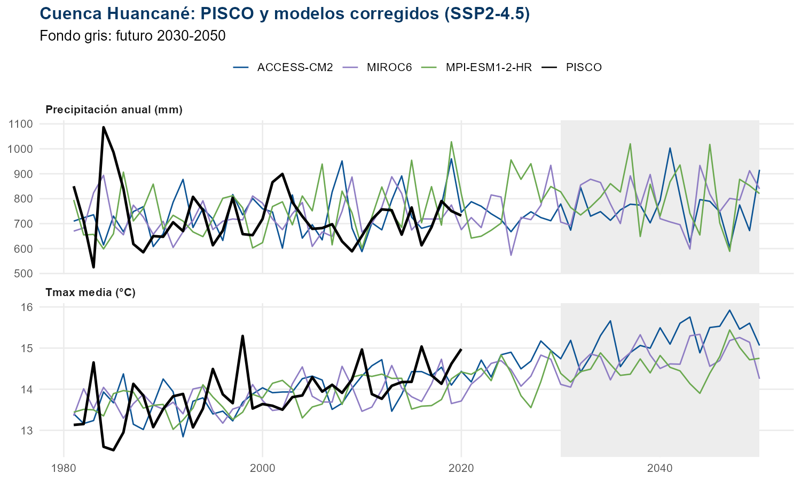{width="80%" fig-align="center"}

::: {.fuente}
Estas series diarias por subcuenca (`data/processed/CMIP6_QM_subcuencas.csv`) son la entrada del modelo GR4J en el bloque 05.
:::

## Modelamiento I {.seccion background-color="#0B5394"}

::: {.num}
04
:::

Modelo GR4J semidistribuido con airGRiwrm: red de subcuencas, calibración y validación

## Introducción al modelo GR4J {.smaller}

:::: {.columns}
::: {.column width="58%"}
::: {.fragment .fade-in}

**Conceptos generales**

- Modelo **conceptual** de lluvia-escorrentía, de paso **diario**, con solo **4 parámetros** libres ($X_1$ a $X_4$).
- Desarrollado por Perrin (2001) a partir del modelo pionero GR3J (Edijatno y Michel, 1989).
- **Validación global**: evaluado en 429 cuencas de climas muy distintos, incluidos climas tropicales.
- **Desempeño**: superó a modelos clásicos como TOPMODEL, Tank, IHACRES, HBV y SMAR (Perrin et al., 2003).
- Entradas: precipitación ($P$) y evapotranspiración potencial ($E$). Salida: caudal ($Q$).

:::
:::

::: {.column width="42%"}
::: {.fragment .fade-in}

{height="560px" fig-align="center"}

:::
:::
::::

## Parámetros del GR4J {.smaller}

:::: {.columns}
::: {.column width="58%"}

::: {style="font-size: 0.68em;"}
| | Parámetro | Qué representa |
|:--|:---|:---|
| $X_1$ | Reservorio de **producción** (mm) | El suelo: reparte la lluvia entre ETP, almacenamiento y percolación. Suelos más profundos → mayor $X_1$. |
| $X_2$ | **Intercambio** subterráneo (mm/día) | $X_2 < 0$: la cuenca pierde agua hacia el acuífero; $X_2 > 0$: la gana. |
| $X_3$ | Reservorio de **tránsito** (mm) | Retención del agua: controla la recesión y el caudal base. |
| $X_4$ | Tiempo base del **UH1** (días) | Rapidez de la respuesta; UH2 dura $2X_4$. |
:::

::: {.fuente}
La lluvia efectiva se reparte siempre en **90 %** por UH1 hacia el reservorio de tránsito (flujo lento) y **10 %** por UH2 directo al río (flujo rápido): ese reparto es fijo, no es un parámetro.
:::

:::

::: {.column width="42%"}

{height="560px" fig-align="center"}

:::
::::

## ¿Por qué semidistribuido?

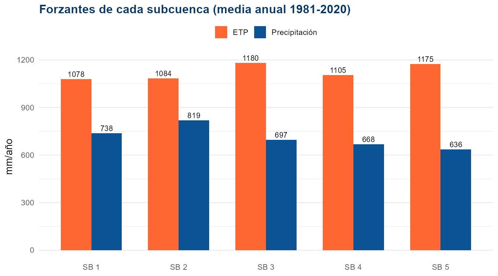{width="78%" fig-align="center"}

::: {.fuente}
La lluvia cambia entre **636 y 819 mm/año** según la subcuenca. Un modelo agregado la promedia; **airGRiwrm** corre GR4J en cada subcuenca y suma los caudales a lo largo del río. Ejercicio: `ejercicios/07_Modelamiento_GR4J.R`.
:::

## La red sale de la tabla de ríos

:::: {.columns}
::: {.column width="56%"}
```r
red <- tramos |>
  mutate(
    id   = as.character(Subbasin),
    down = as.character(SubbasinR),
    down = na_if(down, "0")) |>
  transmute(
    id, down,
    length = largo_km[match(down, id)],
    area   = AreaC / 100,  # km²
    model  = if_else(is.na(down),
                     "RunModel_GR4J",
                     "Ungauged"))

griwrm <- CreateGRiwrm(red)
```

::: {.fuente}
`area` es el área **acumulada** en el nodo. Solo la salida tiene estación: las otras 4 subcuencas son `Ungauged` y heredan los parámetros de la 5.
:::
:::

::: {.column width="44%"}
{width="100%"}
:::
::::

## Esquema de la red

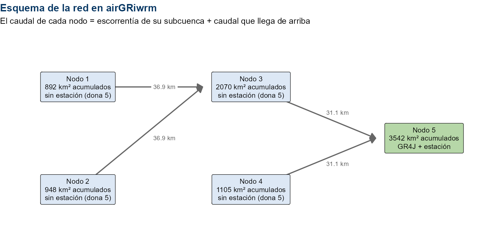{width="92%" fig-align="center"}

::: {.fuente}
`plot(griwrm)` dibuja este esquema con el servicio en línea mermaid.ink (requiere internet). En el script lo construimos con `ggplot2`.
:::

## Entradas del modelo

```r
# Una fila por día, una columna por nodo (mismo orden que la red)
P   <- a_matriz(forzantes, "pp")    #> 14610 x 5  (1981-2020)
ETP <- a_matriz(forzantes, "etp")   # Hargreaves, como en el Día 1

# GR4J trabaja en lámina: m³/s -> mm/día
Qobs <- cbind("5" = q_obs$q * 86.4 / area_salida)

InputsModel <- CreateInputsModel(griwrm,
                                 DatesR  = as.POSIXct(fechas, tz = "UTC"),
                                 Precip  = P,
                                 PotEvap = ETP)
```

. . .

| Periodo | Años | Uso |
|:---|:---:|:---|
| Calentamiento | 1981–1983 | llenar los reservorios del modelo |
| Calibración | 1984–2004 | ajustar los parámetros |
| Validación | 2005–2019 | evaluar con datos que el modelo no vio |

## Calibración con KGE

:::: {.columns}
::: {.column width="66%"}
```r
InputsCrit <- CreateInputsCrit(
  InputsModel,
  FUN_CRIT   = ErrorCrit_KGE2,
  RunOptions = RunOptions_cal,
  Obs        = Qobs[i_cal, , drop = FALSE])

CalibOptions <- CreateCalibOptions(InputsModel)
OutputsCalib <- Calibration(
  InputsModel, RunOptions_cal,
  InputsCrit, CalibOptions)
#> Crit. KGE2[Q] = 0.8563     (~2 minutos)

Param <- extractParam(OutputsCalib)
```
:::

::: {.column width="34%"}
| Parámetro | Valor |
|:---|---:|
| X1 (mm) | 47.6 |
| X2 (mm/d) | 0.32 |
| X3 (mm) | 203.5 |
| X4 (d) | 1.64 |

::: {.fuente}
X1 producción, X2 intercambio con acuíferos, X3 tránsito, X4 tiempo base del hidrograma unitario. Las subcuencas sin estación reciben X1–X3 iguales; X4 se ajusta por el área: 1.43 a 2.28 días (Lobligeois, 2014).
:::
:::
::::

## Desempeño del modelo

{width="82%" fig-align="center"}

| Periodo | KGE | NSE | r | PBIAS | Q obs (m³/s) | Q sim (m³/s) |
|:---|:---:|:---:|:---:|:---:|:---:|:---:|
| Calibración | 0.86 | 0.71 | 0.86 | +0.3 % | 20.2 | 20.2 |
| Validación | 0.81 | 0.76 | 0.87 | −4.1 % | 16.2 | 15.6 |

## Régimen mensual

{width="90%" fig-align="center"}

::: {.fuente}
El modelo reproduce la época de lluvias (diciembre a abril) y la recesión. En los meses secos simula algo más de caudal que el observado.
:::

## Un año de validación, día a día

{width="90%" fig-align="center"}

::: {.fuente}
Año hidrológico 2011–2012: el pico de febrero (~200 m³/s) se subestima, pero la forma de la crecida y la recesión siguen bien al caudal observado.
:::

## Curva de duración

:::: {.columns}
::: {.column width="58%"}
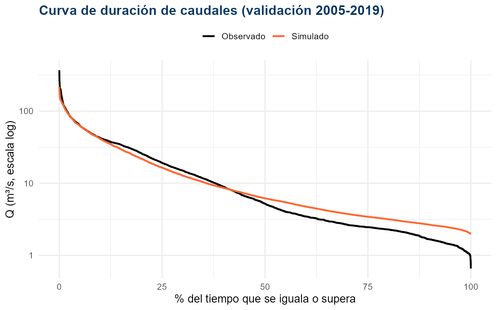{width="100%"}
:::

::: {.column width="42%"}
- Crecidas y caudales medios: **bien representados**.
- Estiaje (más del 50 % del tiempo): el modelo **sobrestima**, ~2.5 m³/s simulados frente a ~1.5 m³/s observados.
- El KGE da más peso a los caudales altos. Para estiajes: `transfo = "sqrt"` o `"log"` en `CreateInputsCrit()` (ejercicio E2).
:::
::::

## Cómo se arma el caudal en la red

{width="78%" fig-align="center"}

::: {.fuente}
El modelo entrega caudal en **todos los nodos**, también donde no hay estación. Con airGRiwrm se pueden agregar extracciones de riego, trasvases o embalses en cualquier nodo.
:::

## Modelamiento II {.seccion background-color="#0B5394"}

::: {.num}
05
:::

Simulación futura (SSP2-4.5) y comparación del régimen de caudales

## El mismo modelo, otro clima

- Se usa el GR4J **calibrado** en el bloque 04 (`outputs/modelo_GR4J_Huancane.rds`): los parámetros no cambian.
- Solo cambian los **forzantes**: lluvia corregida y ETP de Hargreaves con las temperaturas corregidas.
- Cuantiles: una corrida por modelo, de 1981 a 2050; referencia y futuro salen **de la misma corrida**.
- Delta: referencia = PISCO observado; futuro = PISCO perturbado.

. . .

::: {.fuente}
Supuesto fuerte: la cuenca responde en el futuro igual que en 1984–2004 (mismos parámetros, mismo uso del suelo). Es la práctica habitual, pero hay que decirlo.
:::

## Una función para simular cualquier clima

::: {style="font-size: 0.85em"}
```r
simular <- function(forzantes, anios_warmup = 3) {
  f <- forzantes |>
    left_join(latitudes, by = "subcuenca") |>
    mutate(etp = hargreaves(tmax, tmin, lat, fecha))
  # ... matrices de pp y etp con a_matriz() (columnas en el orden de griwrm)
  InputsModel <- CreateInputsModel(griwrm, DatesR = fechas,
                                   Precip = a_matriz("pp"), PotEvap = a_matriz("etp"))
  n_warm <- 365 * anios_warmup
  RunOptions <- CreateRunOptions(InputsModel,
                                 IndPeriod_WarmUp = 1:n_warm,          # 1981-1983
                                 IndPeriod_Run = seq_along(fechas))    # desde 1981
  salida <- RunModel(InputsModel, RunOptions, Param)
  tibble(fecha = fechas, q = attr(salida, "Qm3s")[["5"]])
}

q_qm <- cmip_qm |>
  nest(forzantes = -modelo) |>              # un clima por modelo
  mutate(q = map(forzantes, simular)) |>
  unnest(q)
```
:::

::: {.fuente}
La referencia empieza en 1981 y no hay años previos: se calienta con 1981–1983 y la corrida vuelve a empezar en 1981 con los almacenamientos ya cargados.
:::

## Lluvia: cambio por subcuenca

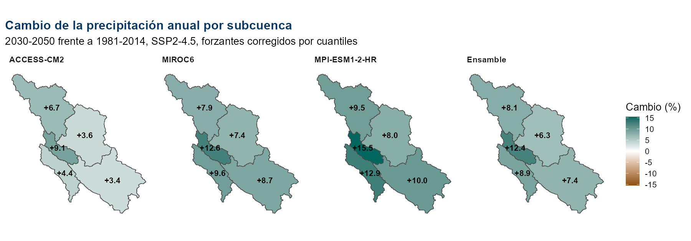{width="100%" fig-align="center"}

::: {.fuente}
Los tres modelos dan **más lluvia** en todas las subcuencas, pero con distinta intensidad: de +3 % (ACCESS-CM2) a +15 % (MPI-ESM1-2-HR). El mayor aumento está en la subcuenca 3, en el centro de la cuenca.
:::

## Evapotranspiración: cambio por subcuenca

{width="100%" fig-align="center"}

::: {.fuente}
La ETP sube en todos los casos (+3 a +7 %), más en la cabecera (subcuenca 1). El modelo que más calienta (ACCESS-CM2, ETP ~+6 %) es el que menos lluvia agrega (~+5 %): por eso es el único en que el caudal **no aumenta**.
:::

## Caudal: cambio por tramo de río

{width="100%" fig-align="center"}

```r
q_nodos <- cmip_qm |>
  nest(forzantes = -modelo) |>
  mutate(q = map(forzantes, \(f) simular(f, nodos = griwrm$id))) |>
  unnest(q)                                  # caudal en los 5 nodos
```

::: {.fuente}
El caudal responde más que la lluvia y no igual en todos los tramos: en el tramo 4 la lluvia sube +9 a +10 % (MIROC6, MPI) y el caudal +22 a +46 %. Con ACCESS-CM2 el tramo 2 pierde caudal (−4 %) porque la ETP (+6 %) crece más que la lluvia (+4 %).
:::

## Régimen de caudales: referencia y futuro

{width="90%" fig-align="center"}

## ¿Cuánto cambia el caudal?

| Modelo | Método | Q medio | Lluvias (dic–mar) | Estiaje (jun–set) |
|:---|:---|:---:|:---:|:---:|
| ACCESS-CM2 | Cuantiles | −0.3 % | −4.0 % | +6.7 % |
| | Delta | −2.1 % | −5.6 % | +1.4 % |
| MIROC6 | Cuantiles | +13.4 % | +11.2 % | +18.9 % |
| | Delta | +17.7 % | +15.3 % | +24.2 % |
| MPI-ESM1-2-HR | Cuantiles | +36.1 % | +46.6 % | +1.2 % |
| | Delta | +40.2 % | +51.3 % | +8.0 % |

. . .

::: {.fuente}
Lluvia +3 a +13 % → caudal −2 a +40 %: el caudal **amplifica** el cambio de la lluvia, y más calor (más ETP) no alcanza a compensarlo. Los dos métodos dan el mismo orden de magnitud; la **diferencia entre modelos** es mucho mayor que la diferencia entre métodos.
:::

## Cambio mes a mes

{width="78%" fig-align="center"}

::: {.fuente}
El cambio más grande está en **dic–ene** (MPI-ESM1-2-HR: +90 a +130 %), mientras que ACCESS-CM2 da menos caudal en esos meses. En estiaje los cambios son menores, salvo MIROC6 en junio (+33 a +42 %).
:::

## Curva de duración

:::: {.columns}
::: {.column width="56%"}
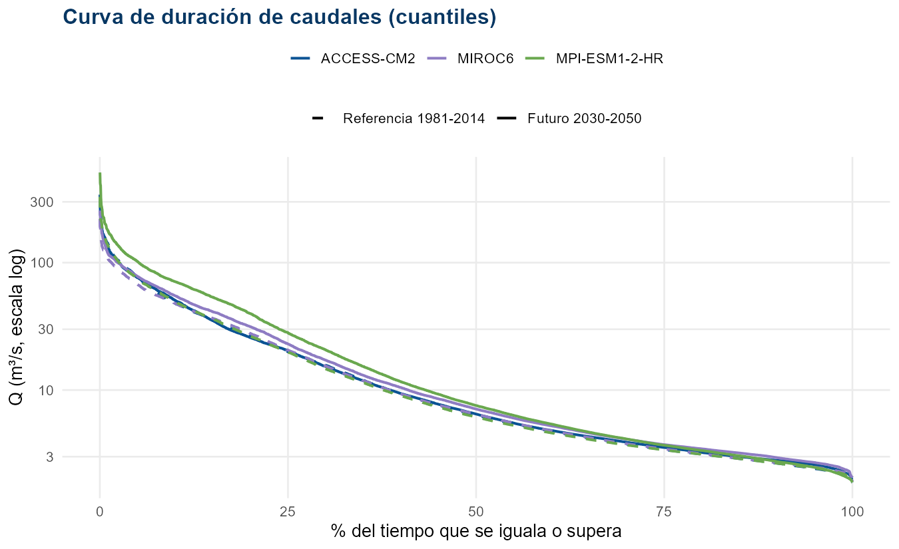{width="100%"}
:::

::: {.column width="44%"}
| | Q10 | Q50 | Q90 |
|:---|:---:|:---:|:---:|
| ACCESS | 48→51 | 6.4→6.5 | 2.7→2.8 |
| MIROC6 | 48→55 | 6.5→7.1 | 2.7→2.9 |
| MPI | 49→71 | 6.1→7.6 | 2.7→2.7 |

m³/s, referencia → futuro
:::
::::

::: {.fuente}
Los caudales **altos** (Q10) son los que más cambian (+6 a +44 %); los caudales bajos (Q90) se mueven poco (+3 a +9 %).
:::

## ¿Qué le decimos al usuario del agua?

- **Temperatura**: señal clara y coherente entre modelos: +0.8 a +1.8 °C hacia 2030–2050.
- **Lluvia y caudal**: los tres modelos van de "sin cambio" a "+36 % de caudal medio": la **incertidumbre** es mayor que la señal.
- El estiaje no disminuye en ningún modelo (+1 a +24 %): buena noticia para la oferta en época seca, pero con solo 3 modelos.
- Un servicio climático no da **un** número: da un **rango** y explica de dónde sale.

. . .

::: {.fuente}
Para un estudio real: más modelos (≥ 10), más escenarios (SSP1-2.6, SSP3-7.0, SSP5-8.5), otros horizontes (2071–2100) y, si se puede, más de un modelo hidrológico.
:::

## Cierre {.seccion background-color="#0B5394"}

::: {.num}
06
:::

R + Python, recursos y rutas de continuación

## El flujo completo en dos días

::: {style="font-size: 0.8em"}
| Paso | Script | Lo que obtuvimos |
|:---|:-:|:---|
| Fundamentos de R | `01` | objetos, data frames, fechas, paquetes |
| Estaciones SENAMHI | `02` `03` | datos ordenados, control de calidad, funciones, bucles |
| Grillados PISCO | `04` | lluvia areal 716 mm/año, ETP, balance P – ETP |
| CC observado | `05` | Tmáx +0.35 °C/década; lluvia sin tendencia |
| CMIP6 + sesgo | `06` | 3 modelos SSP2-4.5 corregidos (cuantiles y delta) |
| GR4J: calibración | `07` | KGE 0.86 (calibración), 0.81 (validación) |
| GR4J: futuro | `08` | caudal medio 2030–2050: de 0 % a +36 % |
:::

::: {.fuente}
Cada script lee lo que produce el anterior: con los datos crudos y los scripts `00`–`08` cualquiera puede **reproducir** todo el análisis.
:::

## R y Python: no compiten

| Tarea | R | Python |
|:---|:---|:---|
| Tablas | `dplyr`, `tidyr` | `pandas`, `polars` |
| Gráficos | `ggplot2` | `matplotlib`, `plotnine` |
| Grillas y NetCDF | `terra`, `ncdf4` | `xarray`, `rioxarray` |
| Vectores (shapefiles) | `sf` | `geopandas` |
| Tendencias | `trend`, `modifiedmk` | `pymannkendall` |
| Corrección de sesgo | `qmap` | `xsdba` (xclim) |
| Métricas de ajuste | `hydroGOF` | `hydroeval`, `HydroErr` |
| Google Earth Engine | `rgee` | `earthengine-api`, `geemap` |

::: {.fuente}
Lo importante es el **método** (control de calidad, corrección de sesgo, calibración), no el lenguaje. Y no hay que elegir: los dos se pueden combinar.
:::

## R + Python con `reticulate`

:::: {.columns}
::: {.column style="width: 60%; font-size: 0.85em"}
```{.r}
library(reticulate)
use_python(Sys.which("python"))

xr <- import("xarray")  # import xarray as xr

ds <- xr$open_dataset(archivo)  # PISCOp v3

# diario -> anual -> promedio de la grilla
anual_py <- ds$pp$
  resample(time = "YE")$sum()$
  mean(c("latitude", "longitude"))$
  to_pandas()

pp_py <- tibble(
  anio = 1981:2025,
  pp_python = as.numeric(anual_py))
```
:::

::: {.column width="40%"}
- El `$` de R reemplaza al `.` de Python.
- `xarray` lee las **fechas** del NetCDF por sí solo.
- El resultado vuelve a R como un vector: se sigue con `tidyverse`.

```{.r}
head(pp_py, 3)
#>    anio pp_python
#> 1  1981      835.
#> 2  1982      683.
#> 3  1983      501.
```
:::
::::

::: {.fuente}
Script `ejercicios/09_R_y_Python.R`. Requiere Python 3 con `pip install xarray netCDF4 pandas`.
:::

## ¿R y Python dan lo mismo?

:::: {.columns}
::: {.column style="width: 45%; font-size: 0.85em"}
```{.r}
# Lo mismo con terra (Día 1)
pp_r <- tapp(r, "years", sum) |>
  global("mean", na.rm = TRUE) |>
  as_tibble() |>
  transmute(anio = 1981:2025,
            pp_r = mean)

comparar <- left_join(pp_py, pp_r) |>
  mutate(dif = pp_python - pp_r)

max(abs(comparar$dif))
#> [1] 0.0001372217
```
:::

::: {.column style="width: 55%; font-size: 0.85em"}
```{.r}
# También se escribe Python directo
py_run_string("
n = ds.pp.sel(time=slice('1991','2020'))
c = n.groupby('time.month').sum() / 30
clim = c.mean(['latitude','longitude'])
")

# Lo de Python se lee con py$
round(py$clim$values, 1)
#>  [1] 127.7 121.7  99.0  40.9  14.9   6.4
#>  [7]   6.0   9.7  22.9  59.4  66.1 111.9
```
:::
::::

::: {.fuente}
Diferencia máxima: 0.00014 mm/año, solo redondeo. Mismo dato + mismo método = mismo resultado, en cualquier lenguaje.
:::

## Recursos para seguir

:::: {.columns}
::: {.column width="50%"}
**Para aprender**

- *R for Data Science* (2.ª ed.), Wickham et al. — [r4ds.hadley.nz](https://r4ds.hadley.nz)
- *Geocomputation with R* — [r.geocompx.org](https://r.geocompx.org)
- *Geocomputation with Python* — [py.geocompx.org](https://py.geocompx.org)
- Slater et al. (2019). Using R in hydrology. *HESS*, 23, 2939–2963. [doi:10.5194/hess-23-2939-2019](https://doi.org/10.5194/hess-23-2939-2019)
- CRAN Task View: Hydrological Data and Modeling — [cran.r-project.org/web/views/Hydrology.html](https://cran.r-project.org/web/views/Hydrology.html)
:::

::: {.column width="50%"}
**Datos**

- **SENAMHI**: estaciones hidrometeorológicas del Perú
- **PISCO**: precipitación y temperatura grillada (SENAMHI)
- **NEX-GDDP-CMIP6** en GEE: `NASA/GDDP-CMIP6`
- **ERA5-Land** en GEE: `ECMWF/ERA5_LAND/DAILY_AGGR`
- **CHIRPS** en GEE: `UCSB-CHG/CHIRPS/DAILY`
:::
::::

## Rutas de continuación

- **Más clima futuro**: más modelos (≥ 10), otros escenarios (SSP1-2.6, SSP3-7.0, SSP5-8.5) y horizontes (2071–2100).
- **Otros modelos hidrológicos**: SWAT, WEAP o los demás modelos GR (`airGR`), y comparar resultados.
- **Demanda de agua**: sumar riego y consumo poblacional al balance para ver la brecha oferta – demanda.
- **Tableros interactivos**: compartir resultados con `shiny` o Quarto Dashboards.
- **Pronóstico**: aprendizaje automático para pronosticar caudales y niveles a corto plazo.

. . .

::: {.fuente}
La regla de oro: **un script por paso**, datos crudos que nunca se tocan, y resultados que se pueden volver a generar.
:::

## Materiales del curso

:::: {.columns}
::: {.column width="48%"}
Todo el curso está en GitHub:

**[github.com/arnoldtraverso/Curso-Taller-R-Hidrologia](https://github.com/arnoldtraverso/Curso-Taller-R-Hidrologia)**

1. Descargar el repositorio (*Code → Download ZIP*).
2. Abrir `Curso-Taller-R-Hidrologia.Rproj`.
3. Ejecutar `00_Instalacion_paquetes.R`.
4. Ejecutar los scripts `01` a `08` en orden.
:::

::: {.column width="52%"}
<pre class="arbol-carpetas"><span class="raiz">Curso-Taller-R-Hidrologia/</span>
<span class="rama">├──</span> <span class="rproj">*.Rproj</span>
<span class="rama">├──</span> <span class="dir">data/</span>
<span class="rama">│   ├──</span> <span class="dir">raw/</span>        <span class="nota">datos crudos</span>
<span class="rama">│   ├──</span> <span class="dir">cmip6/</span>      <span class="nota">modelos CMIP6</span>
<span class="rama">│   └──</span> <span class="dir">processed/</span>  <span class="nota">se generan</span>
<span class="rama">├──</span> <span class="dir">ejercicios/</span>     <span class="nota">scripts 00–09</span>
<span class="rama">├──</span> <span class="dir">outputs/</span>        <span class="nota">resultados</span>
<span class="rama">└──</span> <span class="dir">slides/</span>         <span class="nota">diapositivas</span>
</pre>
:::
::::

::: {.fuente}
El archivo nacional de PISCOp v3 (1.5 GB) no está en el repositorio: el recorte de la cuenca (`PISCOp_v3_diario_Huancane.nc`) sí.
:::

## ¡Gracias! {.seccion background-color="#073763"}

Kevin Arnold Traverso Yucra

Correo: [arnold.traverso@gmail.com](mailto:arnold.traverso@gmail.com)

LinkedIn: [linkedin.com/in/kevin-arnold-traverso](https://www.linkedin.com/in/kevin-arnold-traverso)

GitHub: [github.com/arnoldtraverso](https://github.com/arnoldtraverso)

CIP Puno - Cap. Ingeniería Agrícola · FIAGRH - UNA Puno · IICTA-FIA
